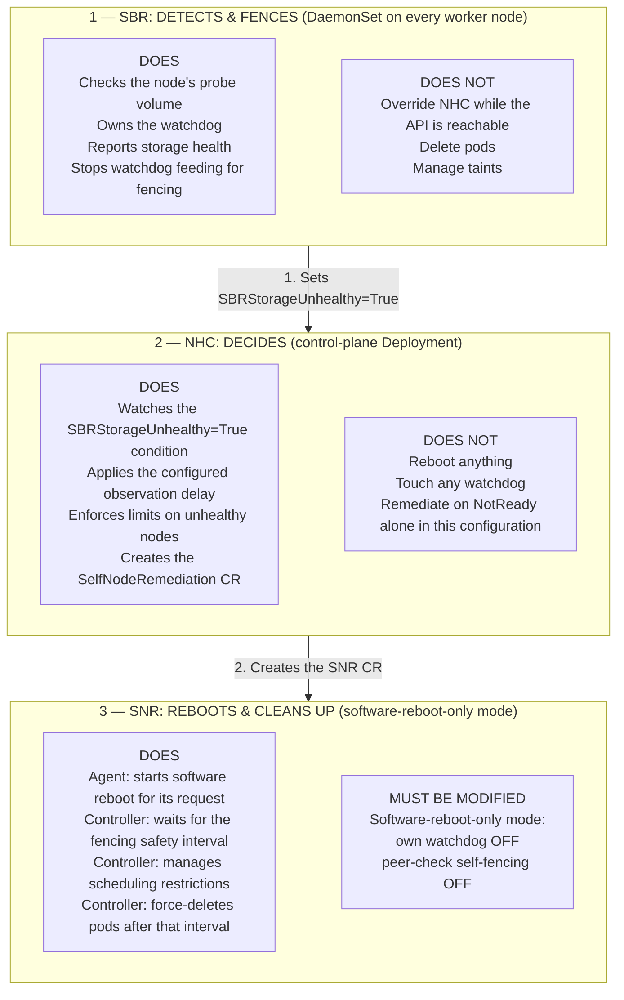
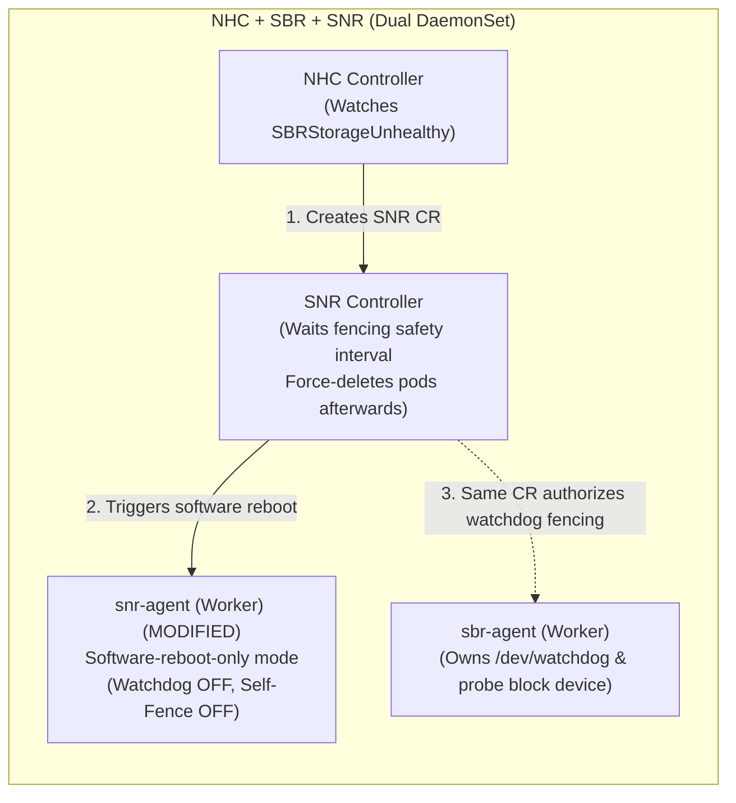
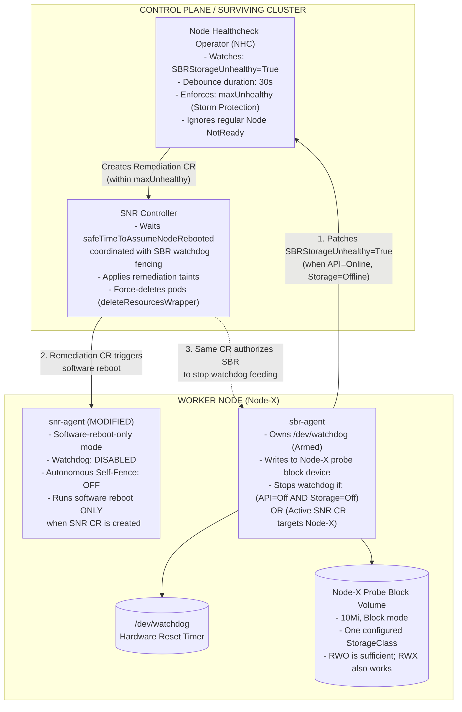
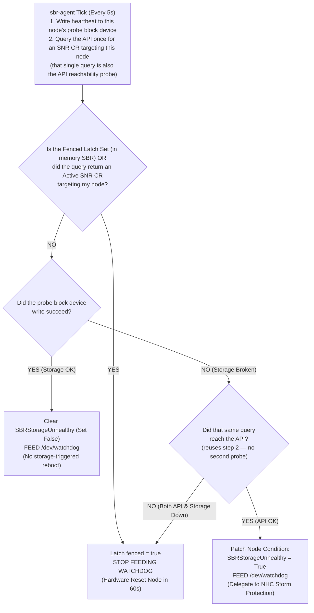
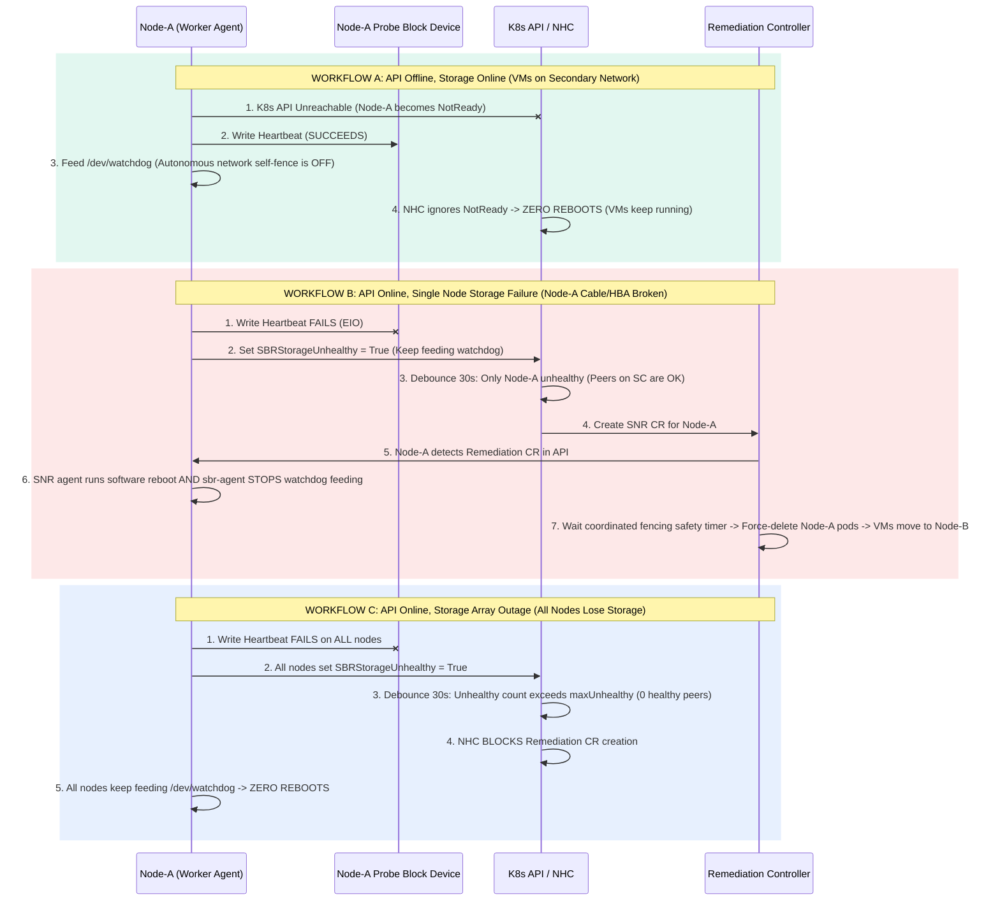
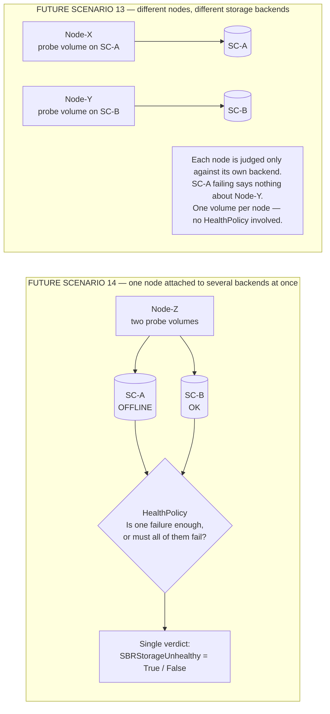

# Storage-Arbitrated Remediation for OpenShift Virtualization

| | |
|---|---|
| **Status** | Proposal — for review |
| **Target release** | 5.9.0 |
| **Tracking** | `RHWA-1839` · `RHWA-1837` · `RFE-9581` |

### Contributors

This proposal came out of several rounds of design discussion and requirements review by:

Daniel Froehlich ([@DanielFroehlich](https://github.com/DanielFroehlich)) ·
Wesley Hayutin ([@weshayutin](https://github.com/weshayutin)) ·
Pranav Gaikwad ([@pranavgaikwad](https://github.com/pranavgaikwad)) ·
Michal Pryc ([@mpryc](https://github.com/mpryc))

### Contents

1. [Introduction](#introduction)
2. [Motivation](#motivation)
3. [Goals](#goals)
4. [Non-Goals](#non-goals)
5. [Design](#design)
6. [Open Questions](#open-questions)
7. [Risks](#risks)
8. [Technical Details](#technical-details)
9. [Future Scope](#future-scope)

## Introduction

This proposal addresses limitations in Storage Based Remediation (SBR) support for RWX Block storage in release 5.9.0.
It introduces a remediation approach for OpenShift Virtualization with one private block probe volume per node.
These volumes provide independent checks of each node's storage access.

The Node Healthcheck Operator (NHC) authorizes remediation through configured health limits.
Self Node Remediation (SNR) provides software reboot and workload cleanup, with hardware watchdog fallback from SBR.
The approach prioritizes storage health over API or cluster-network reachability in node-remediation decisions.
Its goals include continued VM operation during network outages and safe workload recovery after node fencing.
The approach requires changes to SBR and SNR, plus configuration of NHC for storage-health conditions.

## Motivation

SBR's current RWX Block approach depends on concurrent, coherent access to shared heartbeat and fence data.
Some VM storage backends restrict durable writes on a shared block device to one node.
The existing coordination model therefore limits SBR compatibility with these backends.
A private probe volume per node removes the requirement for cross-node access to the same volume.

VMs on dedicated networks can continue operation during Kubernetes API or OVN-Kubernetes outages.
A reboot based only on API or cluster-network reachability can unnecessarily interrupt those workloads.
The proposed approach uses storage health as the primary remediation signal for these environments.

Storage failures also require different responses according to their extent.
An isolated failure can justify node remediation, subject to NHC authorization.
A widespread storage outage requires limits on new remediation requests across the cluster.
Storage failure can also stall software reboot on the affected node.
SBR's hardware watchdog provides a fallback independently of the operating system.

## Goals

- **Broaden block-storage compatibility.** Use one private probe volume per node without concurrent writes or heartbeat inspection from peer nodes.
- **Keep storage-only remediation under NHC control.** With API access, SBR must report storage failures for NHC authorization. Configured health limits must block new requests during a widespread storage outage.
- **Reuse existing operator responsibilities.** NHC retains remediation authorization and health limits. SNR retains reboot orchestration and _workload cleanup_. SBR provides local storage monitoring and hardware watchdog control.


## Non-Goals

- **Changes to RWX Filesystem mode.** This proposal addresses the block-storage approach and its integration with NHC and SNR.
- **Peer coordination through shared storage.** The private probe volumes do not support the existing peer-fencing workflow or persistent inspection of a failed node's heartbeat.
- **General node-failure recovery.** This storage-focused policy does not authorize remediation from `NotReady` alone. It specifically talks about remediations driven through `SBRStorageUnhealthy` condition.
- **A separate workload-cleanup controller in SBR.** SNR remains responsible for workload cleanup through the coordinated remediation sequence.

## Design

A **probe volume**, also called a canary volume, provides a local check of the node's access to the configured storage backend.
Successful writes to this private volume indicate a working storage path for the probe.
They do not establish the health of every VM disk on that node.

### Component responsibilities and required changes

Each selected node runs both `sbr-agent` and `snr-agent`, with separate responsibilities for storage monitoring and software reboot.
SBR has sole ownership of the watchdog throughout normal operation and remediation.
The following table identifies the component changes for this arrangement and the required NHC configuration.

| Component | Responsibility | Required change for this approach |
|---|---|---|
| **SBR** | Local storage monitoring and watchdog fencing. | Private probe volumes, local `SBRStorageUnhealthy` condition reporting, and watchdog decisions from storage health, API access, and the active SNR request. Shared-volume peer coordination is unnecessary in this approach. |
| **SNR** | Software reboot and workload cleanup. | A software-reboot-only mode with its own watchdog and autonomous fencing disabled. Its cleanup timer requires coordination with SBR watchdog fencing. |
| **NHC** | Authorization of remediation and limits on unhealthy nodes. | Configuration for `SBRStorageUnhealthy=True`, an observation delay, health limits, and an SNR remediation template. The proposal uses existing NHC condition and template mechanisms. |

**Diagram 1 — Division of responsibilities: NHC decides, SBR detects and fences, SNR reboots and cleans up**



### Remediation orchestration

1. **Monitor storage.** SBR checks local storage access through regular writes to its node's private probe volume. Successful writes provide the storage-health signal for the node's watchdog decisions.
2. **Report a storage failure.** With API access, SBR publishes `SBRStorageUnhealthy=True` on its own node for NHC evaluation. SBR continues feeding the watchdog pending authorization, including during a storage outage across the cluster.
3. **Authorize remediation.** NHC observes the storage condition for the configured duration before a remediation decision. Its health limits require sufficient healthy nodes for a new request. After these checks, NHC creates a `SelfNodeRemediation` custom resource (CR) for the target node. A `NotReady` condition alone does not satisfy this storage-focused policy.
4. **Start the reboot.** The target SNR agent starts software reboot in response to the active request. The target SBR agent stops feeding the watchdog for that same request. Hardware watchdog expiry provides fallback for a failed or stalled software reboot. SBR's fencing decision remains in effect through temporary network recovery, without a return to watchdog feeding.
5. **Recover workloads.** The SNR controller waits for a safety interval with coverage of SBR watchdog fencing. After that interval, SNR force-deletes the node's workload pods for recovery elsewhere. SNR also manages the remediation taints and their cleanup. Safe Pod deletion depends on effective fencing of the original node before replacement workloads start.

Software reboot and watchdog fallback operate together from the same remediation request, without a separate NHC escalation stage.
The [fencing dependency](#risks) therefore applies to SNR's cleanup deadline as well as to the local reboot actions.

**Diagram 2 — SBR and SNR responsibilities during remediation**



### Behavior without an active remediation request

- **Storage healthy, API unavailable:** SBR continues feeding the watchdog on the basis of local storage health. SNR's proposed mode disables autonomous fencing for API loss or peer isolation. API loss alone therefore causes no reboot through either agent.
- **Storage unhealthy, API available:** SBR reports the local failure through the node condition for NHC evaluation. NHC controls remediation through the configured health limits, with protection against new requests during a widespread storage outage.
- **Storage unhealthy, API unavailable:** SBR stops feeding the watchdog without an API-delivered remediation request. The watchdog resets the powered node after its timeout, independently of a central controller decision.
- **Agent or kernel failure:** An armed hardware watchdog can reset a powered node after the loss of keepalive signals from SBR. This recovery path requires a working watchdog and continued power to the host. Power loss requires external power recovery.

### Scenarios Matrix

The following table covers all the scenarios considered for 5.9.0 release scope.

The outcomes describe the expected behavior of the proposal under the stated conditions.


| Outcome class | Meaning |
|---|---|
| 🟢 **No reboot** | The failure does not trigger node reboot through this policy. |
| 🟠 **Reboot by design** | Software reboot or watchdog fencing applies, subject to the stated prerequisites. |
| 🔵 **Depends on affected nodes** | NHC health limits determine the response. |

| # | Scenario | Node state | What the node agents do | What the cluster does (NHC + controller) | Outcome |
|:--:|---|---|---|---|---|
| **1** | **Healthy steady state** | `API = OK`<br>`Storage = OK` | SBR writes to its probe volume. It feeds the watchdog. It reports `SBRStorageUnhealthy=False`. | No action. | 🟢 **No reboot**<br>VMs run normally. |
| **2** | **Cluster-wide API outage** | `API = Offline`<br>`Storage = OK` | SBR continues feeding the watchdog. SNR's autonomous fencing is disabled. | NHC cannot create remediation CRs. | 🟢 **No reboot**<br>Running VMs can continue through the API outage. |
| **3** | **Cluster-wide storage outage** | `API = OK`<br>`Storage = Offline` | All nodes report `SBRStorageUnhealthy=True`. SBR continues feeding the watchdog without an active request. | After the observation delay, NHC health limits block new CRs. | 🟢 **No reboot** from new requests under the configured limits.<br>Existing requests can continue. |
| **4** | **Loss of API and storage access** | `API = Offline`<br>`Storage = Offline` | SBR stops feeding the watchdog. | No central decision is possible. | 🟠 **Reboot by design**<br>The watchdog resets powered nodes. |
| **5** | **Single-node API / OVN-K partition** | `API = Offline`<br>`Storage = OK` | SBR continues feeding the watchdog. | NHC watches `SBRStorageUnhealthy=True` in this configuration. `NotReady` alone triggers no request. | 🟢 **No reboot**<br>VMs on working dedicated networks can continue. |
| **6** | **Single-node storage failure** | `API = OK`<br>`Storage = Offline` | SBR reports `SBRStorageUnhealthy=True`. The active SNR CR triggers software reboot and SBR watchdog fencing. | NHC creates the SNR CR within its health limits. SNR waits for the fencing safety interval before forced Pod deletion. | 🟠 **Reboot by design**<br>VM recovery follows fencing and cleanup. |
| **7** | **Kernel panic / freeze / power loss** | Node frozen or without power | Keepalive signals stop. An armed hardware watchdog can reset a powered host. | Recovery depends on node restart or restoration of power. The node cannot publish a new storage condition during the failure. | 🟠 **Reboot by design** for a powered, hung host.<br>The watchdog cannot restore power. Automatic VM failover is not guaranteed. |
| **8** | **Planned `sbr-agent` upgrade or restart** | `API = OK`<br>`Storage = OK` | SBR disarms the watchdog on graceful shutdown. Startup awaits the probe device before watchdog arming. | No remediation action. | 🟢 **No reboot** under the planned shutdown and [startup procedure](#startup-and-volume-lifecycle). |
| **9** | **Hung kubelet** | `API = OK`<br>`Storage = OK` | The running SBR agent continues feeding the watchdog. | `SBRStorageUnhealthy` remains `False`. `NotReady` alone triggers no request. | 🟢 **No reboot**<br>This policy leaves running VMs undisturbed. |
| **10** | **Slow / hanging storage (`D-state`)** | `API = OK`<br>`Storage I/O timed out` | SBR treats the timeout as storage failure. The watchdog loop remains independent of storage I/O. | Scenario 3 or 6 applies, according to the number of affected nodes. | 🔵 **Depends on affected nodes**<br>Hung I/O must not block watchdog feeding. |
| **11** | **Network partition between node groups** | `API = Offline`<br>`Storage = OK` | Isolated nodes continue feeding the watchdog. | This policy does not authorize Pod deletion or VM relocation for network loss alone. | 🟢 **No reboot**<br>No relocation through this policy solely because of the partition. |
| **12** | **Last-second network recovery** | SBR has committed to fencing | SBR never resumes watchdog feeding after that decision. | SNR waits for the full fencing safety interval before Pod deletion. | 🟠 **Reboot by design**<br>Network recovery does not cancel committed fencing. |
| **15** | **Un-evictable / stuck terminating pod** | Remediation authorized | SNR attempts software reboot. SBR stops feeding the hardware watchdog. | SNR manages taints and forced Pod deletion after the fencing safety interval. | 🟠 **Reboot by design**<br>Forced cleanup follows watchdog fencing. |

> The reboot scenarios depend on a working hardware watchdog after agent startup.
> Protection during a widespread storage outage depends on NHC health limits with a healthy-node requirement.
> Already-authorized requests can continue during such an outage, despite a block on new requests.

## Open Questions

- Should 5.9.0 retain the existing shared-volume RWX Block mode alongside this approach, or replace it completely?

## Risks

- **Fencing before forced cleanup.** Expiry of the SNR timer alone does not establish shutdown of the original node. Safe cleanup requires an armed SBR watchdog, a committed stop to feeding, and a cleanup deadline after the watchdog reset interval. A missed request or an incorrect deadline could permit workload copies on two nodes with simultaneous access to their data.
- **Widespread storage failure.** Protection against new remediation requests depends on NHC configuration and timely storage-health reports. Requests already in progress can continue despite the subsequent outage. Loss of API access at the same time also triggers local watchdog fencing, outside NHC's control of new requests.
- **Startup and upgrades.** Probe-volume provisioning creates a temporary period without watchdog protection on the affected node. The SNR mode transition requires coordination of watchdog ownership between the agents. SBR must become the sole watchdog owner before normal operation under the proposed approach.

## Technical Details

### Component architecture

The following diagrams show the agents, controllers, and storage connections behind the high-level orchestration.
The proposed timing examples use a 5-second agent tick, a 30-second NHC observation delay, and a 60-second watchdog timeout.
These values illustrate the expected sequence of checks and actions within the design.
They do not establish safe cleanup without the watchdog coordination requirements in [Risks](#risks).

**Diagram 3 — Component architecture: NHC + SBR + SNR**



### Local node decision flow

**Diagram 4 — Local watchdog decision flow: one API query per agent tick**



The agent's remediation lookup supplies both the request decision and evidence of current API reachability.
The result distinguishes an active request, a successful response without a request, and an unreachable API.
A successful response without a request permits continued watchdog feeding under NHC control during a storage failure.
An unreachable API together with failed storage requires local fencing without NHC authorization.

The agent must base this distinction on the actual API call result for the current check.
A cached informer response can contain an earlier absence of requests despite a subsequent network failure.
That response cannot establish current API reachability for the watchdog decision.

Storage I/O runs separately from the watchdog loop, with a timeout for a failed or stalled probe operation.
Expiry of the proposed 15-second I/O timeout marks the storage path as unhealthy for the decision above.
The separate watchdog loop permits continued feeding during storage-only failures pending NHC authorization.
A blocked storage operation must not cause an unintended watchdog reset during that wait.

After commitment to fencing, the agent must not resume watchdog feeding during temporary API or storage recovery.
This rule preserves the controller's cleanup timing through last-second recovery of either connection.
Otherwise, resumed feeding could leave the original workloads active beyond the assumed fencing deadline.

### Cluster-level failure workflows

**Diagram 5 — NHC decisions during API loss and storage failures**



### Component deployment and high availability

| Component | Per-node agents | Controller placement | Role and high-availability behavior |
|---|---|---|---|
| **SBR** | One `sbr-agent` pod per selected node. | Operator Deployment; leader-elected reconciler inside the agents. | Each agent owns its probe device and watchdog. Local storage reporting does not require the elected leader. Agent reconcilers participate in Kubernetes Lease election. Another healthy agent can take the leader role after failure. |
| **NHC** | None. | Control-plane Deployment with leader election. | NHC observes node conditions. It applies the observation delay and health limits before an SNR request. |
| **SNR** | One `snr-agent` pod per selected node. | Controller Deployment. | The target agent performs software reboot. The controller manages taints, the reboot safety timer, and forced Pod deletion. |

### Reboot orchestration and the SNR dependency

The combined NHC + SBR + SNR approach reuses SNR's reboot-timer and Pod-deletion controller for workload cleanup after fencing.
This division avoids a second cleanup implementation in SBR, with continued use of SNR's remediation lifecycle.
The deployment requires both operator Deployments and both agent DaemonSets for SBR and SNR.

SNR requires a software-reboot-only mode with its own watchdog and autonomous peer-check fencing disabled.
SBR retains exclusive ownership of `/dev/watchdog` for storage-based fencing decisions.
With API access, NHC authorizes remediation through the SNR request for the target node.
Loss of both API access and storage remains a local SBR fencing condition without a controller request.

The SNR controller uses `safeTimeToAssumeNodeRebooted` before cleanup through `deleteResourcesWrapper`.
The proposed integration must coordinate this deadline with the target node's committed SBR watchdog fencing.
A successful software-reboot command alone does not prove host shutdown before the cleanup deadline.
The watchdog fallback therefore remains necessary for an unsuccessful or stalled software reboot.

### Why the earlier proposals needed adjustment

#### Shared-volume coordination: RHWA-1839

- **Workflow 1A — Attachment limits.** Peer heartbeat inspection can require *N−1* peer volumes per node. At 100 nodes, these attachments compete with VM disks for Linux and CSI device limits. The private-volume approach requires one probe attachment per node.
- **Workflow 1B — Single-writer storage.** Some shared-block backends, such as Portworx, restrict durable writes to one node. A healthy peer's fence write can block behind the target's storage access. A private probe volume removes the cross-node fence-write requirement.
- **Workflow 1C — Stale cached reads.** Cross-node heartbeat inspection depends on coherent direct I/O. A stale cached sector can produce an incorrect fencing decision. The private-volume approach removes peer heartbeat reads.

#### Storage failure with NHC-controlled fencing: RHWA-1837 / RFE-9581

An earlier proposal continued watchdog feeding during storage failure until a fence message arrived on storage.
The failed storage path also prevented access to that message.
The target could therefore remain active beyond the controller's assumed reboot deadline.
Forced cleanup at that point could permit simultaneous workload copies.

This proposal uses the active SNR request through the API for authorized watchdog fencing.
Loss of both API access and storage independently stops watchdog feeding.

#### Refinements to the combined SBR and SNR workflow

- **Workflow 3A — Software reboot blocked by storage.** Processes such as `qemu-kvm` can enter uninterruptible `D-state` during storage failure. A software reboot can then stall without termination of the original workloads. SBR must stop watchdog feeding for the active request as a hardware fallback within the fencing safety interval.
- **Workflow 3B — Failed node without a new storage report.** A node without power or API access cannot publish `SBRStorageUnhealthy=True`. A powered, hung host can recover through its armed watchdog. The proposed volume lifecycle does not support persistent peer inspection. Automatic workload failover is therefore not guaranteed in this case.

### Per-node volume mechanism

Each SBR agent uses a private 10 Mi block-mode PersistentVolumeClaim (PVC) as its node's storage-health probe.
One attachment per node avoids shared-node-map contention and concurrent-writer coordination.

#### DaemonSet constraint

- `PersistentVolumeClaimVolumeSource` accepts a fixed `claimName` and a `readOnly` flag, without per-node name substitution.
- `DaemonSetSpec` has no `volumeClaimTemplates` field for individual claims from a common workload template. `StatefulSetSpec` provides that capability for StatefulSet pods.

The proposal therefore uses a generic ephemeral volume in each agent pod for a separate PVC from one common DaemonSet template.

#### Decision: generic ephemeral volumes

The agent DaemonSet declares one `ephemeral.volumeClaimTemplate` for the configured `StorageClass`.
Kubernetes creates a separate PVC from this template for each agent pod, with the pod as the claim's owner.
Pod deletion therefore triggers garbage collection of the associated PVC.
The StorageClass reclaim policy determines subsequent deletion or retention of the underlying volume.
See the [Kubernetes volume lifecycle documentation](https://kubernetes.io/docs/concepts/storage/ephemeral-volumes/#lifecycle-and-persistentvolumeclaim).

```yaml
volumes:
  - name: canary-backend-0
    ephemeral:
      volumeClaimTemplate:
        spec:
          accessModes: ["ReadWriteOnce"]
          volumeMode: Block
          storageClassName: <backend>
          resources: { requests: { storage: 10Mi } }
```

This choice retains Kubernetes management of DaemonSet scheduling, node placement, and rolling upgrades.
The probe volume contains disposable health-check data without a persistent peer-history requirement.

Two alternatives were considered:

- **One pinned StatefulSet per node.** Stable volumes would provide persistent storage identity for each node. However, the operator would require a separate workload for each of the *N* nodes, with immutable `volumeClaimTemplates` in each StatefulSet.
- **A mutating Pod webhook for `claimName`.** A webhook could select the node-specific claim during Pod creation. This would add a webhook dependency to fencing-agent startup, including during recovery from an agent failure.

#### Startup and volume lifecycle

**Peer inspection is unavailable in this design (scenario 7).** The agent pod owns the PVC throughout its lifetime.
Pod removal can also remove the probe volume and its last heartbeat, according to the reclaim policy.
A surviving node therefore has no persistent probe-history guarantee for assessment of the failed node.
NHC must rely on the last reported node condition during an unreported failure.

**Pod recreation provisions a new volume (scenario 8).** Each replacement agent pod receives its own PVC from the DaemonSet's volume template.
A container restart within the original pod retains that pod's existing PVC.
A node reboot alone does not require Pod replacement or a new probe volume.
The lifetime of the Pod object, rather than the agent process or node boot, determines this distinction.

The agent must delay watchdog arming until successful opening of the probe device at startup.
This behavior avoids a reboot due solely to the provisioning or attachment delay for the new volume.
On graceful shutdown, the proposed agent writes the magic close character (`V`) to `/dev/watchdog` for disarming.
That procedure requires a watchdog configuration with disarm support across the planned restart.
An unexpected agent failure after watchdog arming can still cause expiry and node reset.
Backend validation must measure the temporary protection gap from volume provisioning and attachment during startup and upgrades.

**PVC names are pod-derived.** Kubernetes names each claim `<pod-name>-<volume-name>`, including the generated suffix of its DaemonSet pod.
The operator exposes a node-to-PVC mapping in status for identification of the current probe volume.
The volume label in Diagram 3 describes the device's role rather than a stable claim name.

**RWO access is sufficient.** Single-node ownership of each probe volume removes the need for cross-node write access.
An RWX block backend can also provide the private volume under the same single-writer arrangement.

#### Constraint on revisiting the volume choice

Persistent peer inspection would require a volume lifecycle beyond the lifetime of the failed node's agent pod.
The alternative under consideration used stable per-node PVCs, for example through pinned StatefulSets.
Adoption of that alternative would require a planned transition of the fencing-agent workload and its storage ownership.

## Future Scope

This section describes extensions beyond the single-StorageClass scope of 5.9.0.
Their inclusion records possible design directions without a commitment to a later release.

### Scenarios 13 and 14: multiple StorageClasses

The two scenarios differ in storage placement and the resulting health decision.
Scenario 13 assigns one backend to each node, with different backends across the cluster and an independent storage verdict for each node.
Scenario 14 attaches several backends to one node, with a policy requirement for a single verdict from their individual results.

| # | Scenario | Node state | Proposed behavior | Scope |
|:--:|---|---|---|---|
| **13** | **Different nodes, different storage** | `Node-X → SC-A only`<br>`Node-Y → SC-B only` | Each node uses a probe volume from its own StorageClass. Storage health is local to that node's backend. Failure of SC-A does not establish failure of Node-Y's storage. | Future scope; one volume per node. |
| **14** | **One node, several storage backends** | `Node-Z → SC-A = Offline`<br>`Node-Z → SC-B = OK` | SBR monitors each probe volume. `HealthPolicy` produces one `SBRStorageUnhealthy` verdict. NHC acts on that condition. | Future scope; several volumes per node. |

**Diagram 6 — Future scenarios 13 and 14: storage placement and HealthPolicy**



### HealthPolicy

A node with several probe volumes still needs one `SBRStorageUnhealthy` verdict for NHC's remediation decision.
`HealthPolicy` would define that verdict from the individual device results, including partial failure of the node's storage backends.
Two possible rules illustrate the choice:

- Any backend failure marks the node unhealthy.
- All backends must fail before the node becomes unhealthy.

The appropriate rule depends on VM disk placement and the desired response to partial storage loss.
An any-failure rule favors remediation after loss of a backend for VM disks.
An all-failures rule permits continued node operation with some storage still available.
`NodeStorageClasses` and `HealthPolicy` belong to this future work, outside the 5.9.0 configuration.

### Volume and deployment implications

- **Scenario 13:** A DaemonSet has one common pod template for its selected nodes. Different StorageClasses across those nodes would therefore require separate templates. The proposed extension uses one operator-managed DaemonSet per StorageClass group for the corresponding nodes.
- **Scenario 14:** Generic ephemeral volumes permit a separate volume entry for each backend in the same pod template. Each entry would specify the corresponding `storageClassName` for its probe volume. `HealthPolicy` would combine the individual probe results into the node's storage-health verdict.

Both extensions concern the placement and evaluation of disposable probe volumes, without an inherent requirement for persistent probe data.
The generic ephemeral volume choice therefore remains compatible with these future configurations.
Replacement of probe volumes would avoid data migration for the health-check records.
The controller, configuration, and policy changes would still require a separate design and validation before support for either scenario.
