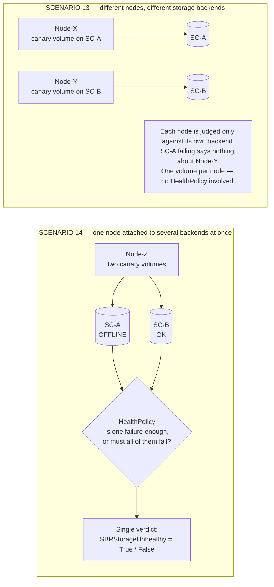
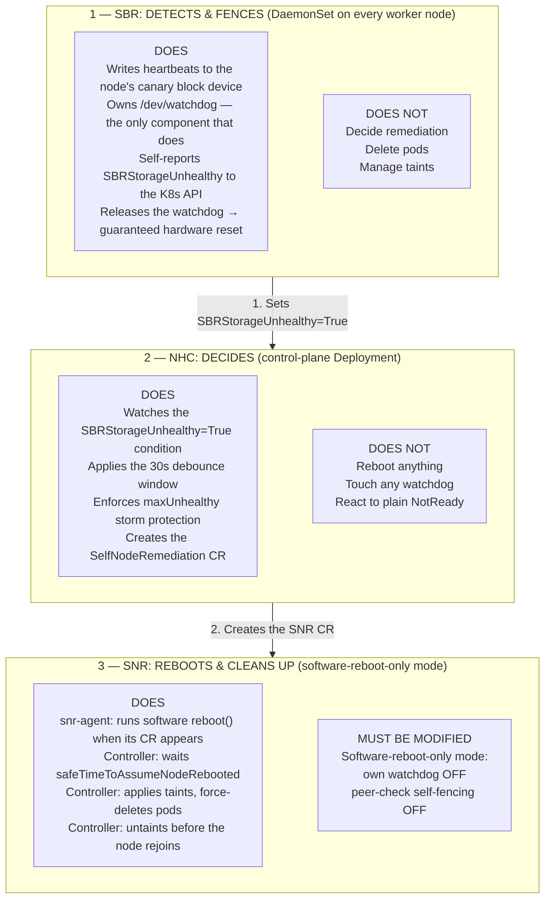
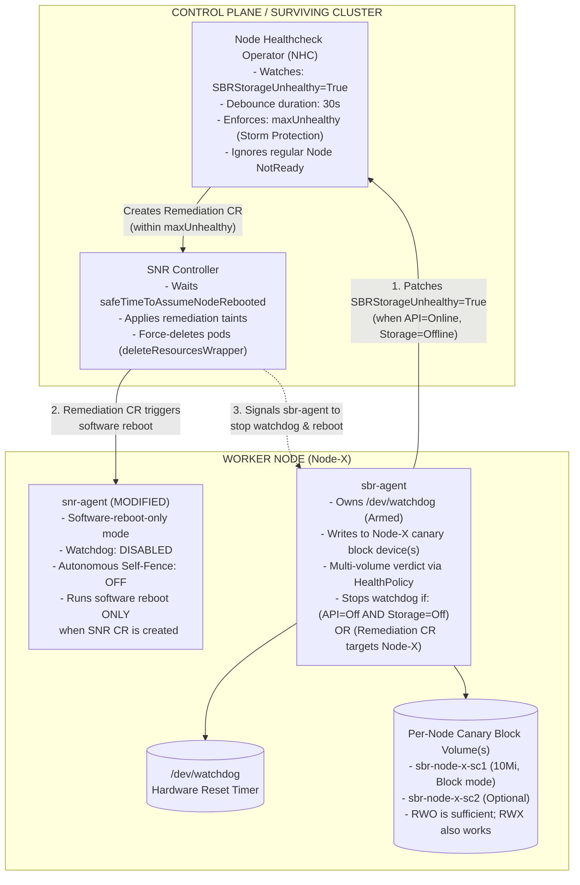
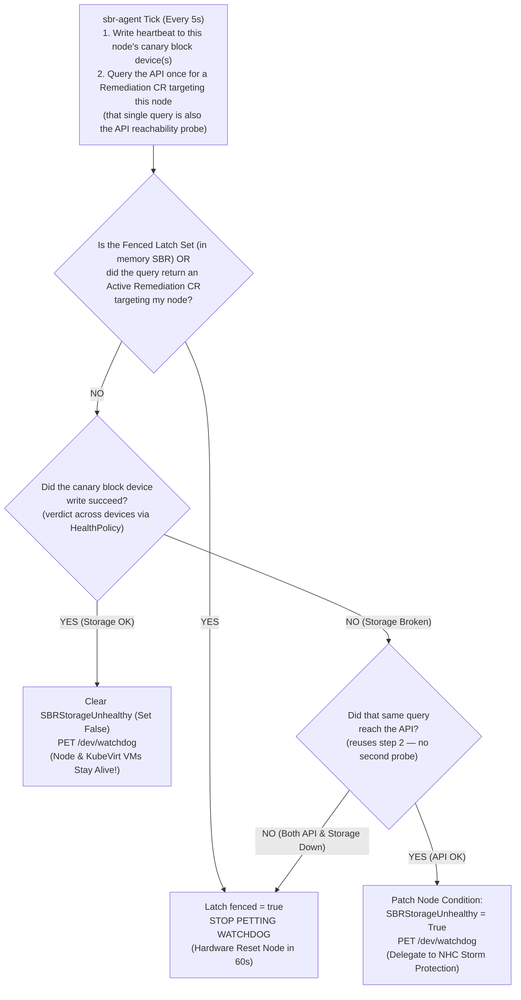
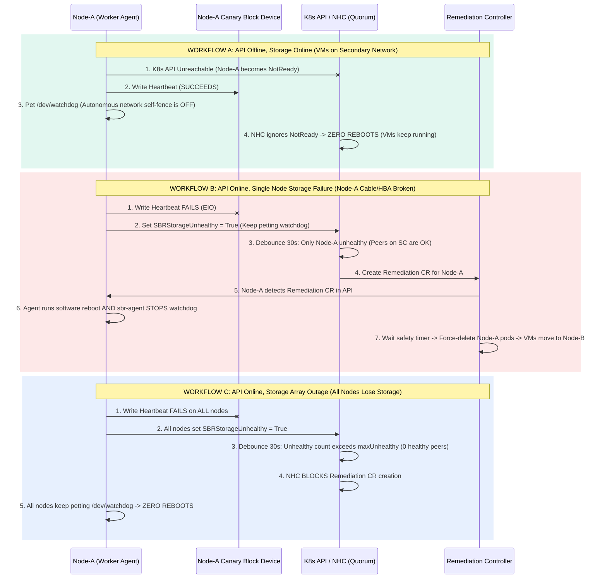
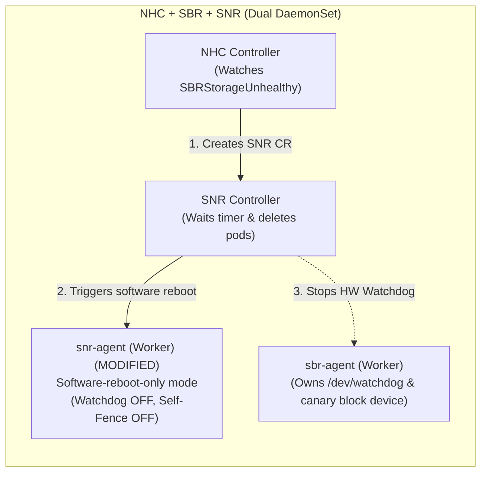

# Storage-Arbitrated Remediation for OpenShift Virtualization

**A storage-aware node remediation stack — NHC + SBR + SNR — that works across every certified CSI block driver, keeps virtual machines running through API and network outages, and reboots a node only when storage arbitration proves it is genuinely unsafe to leave it alone.**

| | |
|---|---|
| **Status** | Proposal — for review |
| **Target release** | 5.9.0 |
| **Tracking** | `RHWA-1839` · `RHWA-1837` · `RFE-9581` |

### Contributors

This proposal came out of several rounds of design discussion and requirements review by:

Daniel Froehlich ([@DanielFroehlich](https://github.com/DanielFroehlich)) ·
Wesley Hayutin ([@weshayutin](https://github.com/weshayutin)) ·
Pranav Gaikwad ([@pranavgaikwad](https://github.com/pranavgaikwad)) ·
Michal Pryc ([@mpryc](https://github.com/mpryc))

### Contents

1. [Complete 15-scenario verification matrix](#1-complete-15-scenario-verification-matrix)
2. [Executive summary](#2-executive-summary)
3. [Why the earlier proposals needed adjustment](#3-why-the-earlier-proposals-needed-adjustment)
4. [System architecture and decision diagrams](#4-system-architecture-and-decision-diagrams)
5. [Component deployment topology and high availability](#5-component-deployment-topology-and-high-availability)
6. [Reboot orchestration and pod cleanup](#6-reboot-orchestration-and-pod-cleanup)
7. [Per-node volume mechanism](#7-per-node-volume-mechanism) — *implementation decision*

---

## 1. Complete 15-Scenario Verification Matrix

This is the acceptance surface for the design: every failure mode the stack is expected to survive, and the behaviour it must produce. Each row states what the node agent does locally, what the cluster decides centrally, and the resulting outcome for the customer's virtual machines.

**15 scenarios covered** — spanning API outages, storage outages, kernel hangs, upgrades and mixed-storage topologies.

| Outcome class | Count | Meaning |
|---|---|---|
| 🟢 **No reboot** | 7 | Node keeps feeding the hardware watchdog; VMs are undisturbed. |
| 🟠 **Reboot by design** | 5 | Node is reset — by remediation or by the watchdog — and workloads recover elsewhere. |
| 🔵 **Policy-driven** | 3 | Behaviour depends on the configured `HealthPolicy`, or escalates into another scenario. |

> **ℹ️ Note** — Every row is labelled with its outcome class, so the colour is a convenience and never the only signal.

| # | Scenario | Node state | What the node agent(s) do | What the cluster does (NHC + controller) | Outcome |
|:--:|---|---|---|---|---|
| **1** | **Healthy steady state** | `API = OK`<br>`Storage = OK` | Writes to its canary block device, pets `/dev/watchdog`, holds `SBRStorageUnhealthy=False`. | No action. | 🟢 **No reboot**<br>VMs run normally. |
| **2** | **Cluster-wide API outage** | `API = Offline`<br>`Storage = OK` | Sees `Storage=OK` and keeps petting `/dev/watchdog`. Network self-fencing is disabled. | API is down; NHC cannot create remediation CRs. | 🟢 **No reboot**<br>VMs keep running. |
| **3** | **Cluster-wide storage outage** | `API = OK`<br>`Storage = Offline` | All nodes set `SBRStorageUnhealthy=True`. Because `API=OK`, they keep petting the watchdog unless a CR targets them. | After the debounce window, `maxUnhealthy` and the zero-healthy-peer check block CR creation. | 🟢 **No reboot**<br>Storm protection prevents a mass reboot. |
| **4** | **Total datacenter outage** | `API = Offline`<br>`Storage = Offline` | Sees both planes gone and stops petting `/dev/watchdog`. | Both planes are dead; no central decision is possible. | 🟠 **Reboot by design**<br>Nodes reset via hardware watchdog. |
| **5** | **Single-node API / OVN-K partition** | `API = Offline`<br>`Storage = OK` | Sees `Storage=OK` on its canary block device and keeps petting `/dev/watchdog`. | Node is `NotReady`, but NHC watches only `SBRStorageUnhealthy=True`. | 🟢 **No reboot**<br>VMs on dedicated networks stay up. |
| **6** | **Single-node storage failure** | `API = OK`<br>`Storage = Offline` | Sets `SBRStorageUnhealthy=True`. When the CR appears, runs the software reboot *and* stops the watchdog. | NHC creates a remediation CR; the controller waits out the safety timer, then force-deletes pods on the node. | 🟠 **Reboot by design**<br>Node reboots; VMs fail over. |
| **7** | **Kernel panic / freeze / power loss** | Node frozen or dead | `sbr-agent` is frozen or gone, so the watchdog is no longer fed — hardware reset within 60s. | **5.9.0:** recovers post-reboot. **Post-5.9.0 peer inspection is not available** with the chosen volume mechanism — see [§7](#7-per-node-volume-mechanism). | 🟠 **Reboot by design**<br>Hardware watchdog recovers the hung host. |
| **8** | **`sbr-agent` upgrade or restart** | `API = OK`<br>`Storage = OK` | On `SIGTERM` writes the magic close character (`'V'`) to `/dev/watchdog`, disarming the timer across the restart. | No action. | 🟢 **No reboot**<br>No false reboots during upgrades. Requires the fail-open warm-up in [§7](#7-per-node-volume-mechanism). |
| **9** | **"Zombie kubelet" (kubelet hung)** | `API = OK`<br>`Storage = OK` | `sbr-agent` sees `Storage=OK` and keeps petting `/dev/watchdog`. | Node is `NotReady`, but `SBRStorageUnhealthy` remains `False`. | 🟢 **No reboot**<br>Running VMs are undisturbed. |
| **10** | **Slow / hanging storage (`D-state`)** | `API = OK`<br>`Storage hung > 15s` | Storage I/O runs in a separate goroutine with a timeout and is treated as `Storage=Offline`. | Resolves into scenario 3 (storm-protected) or scenario 6 (single node). | 🔵 **Policy-driven**<br>Hung I/O never starves the watchdog loop. |
| **11** | **Split-brain network partition** | `API = Offline`<br>`Storage = OK` | Minority nodes keep petting `/dev/watchdog` while storage stays healthy. | NHC does not delete pods or move VMs unless storage is unhealthy or revoked. | 🟢 **No reboot**<br>Zero split-brain. |
| **12** | **Last-second network recovery** | Remediation CR active | **Point-of-no-return latch:** once fenced, the agent never resumes petting the watchdog. | Controller waits out the full reboot timer before deleting pods. | 🟠 **Reboot by design**<br>Zero race condition. |
| **13** | **Different nodes, different storage**<br>*one volume each, but not the same backend* | `Node-X → SC-A only`<br>`Node-Y → SC-B only` | Each node attaches a canary volume from *its own* `StorageClass`. `Node-X` never reads or depends on `Node-Y`'s storage. | Health is judged per node, against that node's own backend. A failure of `SC-A` says nothing about `Node-Y`. | 🔵 **Policy-driven**<br>Mixed-backend clusters work; one node's outage never implicates another. **Deferred past 5.9.0** — see [§7](#7-per-node-volume-mechanism). |
| **14** | **One node, several storage backends**<br>*a single node attached to two at once* | `Node-Z → SC-A = Offline`<br>`Node-Z → SC-B = OK` | Monitors every canary device the node owns and evaluates the results against the configured `HealthPolicy`. | NHC acts on the single `SBRStorageUnhealthy` condition the policy produced. | 🔵 **Policy-driven**<br>`HealthPolicy` defines which combination of failures warrants a reboot. **Deferred past 5.9.0** — see [§7](#7-per-node-volume-mechanism). |
| **15** | **Un-evictable / stuck terminating pod** | Remediation triggered | Node reboots via software reboot plus release of the SBR hardware watchdog. | Controller applies the taint and force-deletes pods (`GracePeriod=0`) before untainting. | 🟠 **Reboot by design**<br>Stuck pod is deleted before the node rejoins. |

### Scope for 5.9.0

The matrix above is the full behavioural target. Not all of it lands in one release.

**In scope for 5.9.0**

- **Per-node canary volumes.** Each node exercises a block volume of its own rather than writing into
  a slot in one volume shared by the whole cluster. This is the change that makes the stack work on
  backends that block concurrent writes or offer only `ReadWriteOnce`.
- **A single `StorageClass`**, cluster-wide. Every node's canary comes from the same backend.
- **Both arbitration models ship.** Existing deployments keep the shared-volume behaviour they have
  today, unchanged and unaffected by upgrade. New deployments get per-node volumes. The model is
  selectable per deployment, so adopting the new one is a deliberate act.
- **Scenarios 1–12 and 15**, as described in the matrix.
- **The SNR change** in [§6](#6-reboot-orchestration-and-pod-cleanup) — the software-reboot-only mode.
  It lives in another repository and gates scenarios 6 and 15.

**Out of scope for 5.9.0**

- **Scenario 13** — different `StorageClasses` on different nodes.
- **Scenario 14** — several `StorageClasses` on a single node, and the `HealthPolicy` that would
  arbitrate between them. Deferred as a scope decision, not a technical barrier.
- **Scenario 7's peer inspection** — a surviving node attaching a dead node's volume to read its last
  heartbeat. This one is **dropped rather than deferred**; see [§7](#7-per-node-volume-mechanism) for
  why, and note the node is still recovered by the hardware watchdog regardless.
- **Retiring the shared-volume model.** It remains supported; there is no forced migration.

### Reading scenarios 13 and 14: two different questions

These two rows are often confused because both mention several `StorageClasses`. They are asking different things. **Scenario 13 is about the cluster** — nodes do not all have to use the same storage backend, and each node is judged only against its own. **Scenario 14 is about a single node** — one node attached to two backends at once, where something has to decide whether losing one of them is grounds for a reboot. That decision is the `HealthPolicy`.

**Diagram 1 — Scenario 13 vs. scenario 14: per-node storage, and per-node *policy***



> ### 🔑 `HealthPolicy` — the knob that decides when storage loss means "reboot"
>
> *Design for the multi-backend work. **Not in 5.9.0**, which ships a single `StorageClass` per node — see [§7](#7-per-node-volume-mechanism).*
>
> A node with more than one canary volume needs a rule for turning several device results into the one `SBRStorageUnhealthy` condition NHC watches. `HealthPolicy` is that rule — for example *"any one backend failing marks the node unhealthy"* (safest for VMs whose disks could be on either backend) versus *"all backends must fail"* (avoids rebooting a node that can still serve some of its workloads). It is deliberately a policy rather than hard-coded behaviour, because the right answer depends on how the customer spreads VM disks across their storage.

---

## 2. Executive Summary

OpenShift Virtualization (KubeVirt) requires a storage-aware remediation stack that works across **all** certified CSI block drivers — including backends that block concurrent writes (for example Portworx) or support only `ReadWriteOnce` (`RWO`) — while respecting Node Healthcheck Operator (NHC) storm protection (`maxUnhealthy`) and avoiding unnecessary VM disruption during Kubernetes API or OVN-Kubernetes network outages.

> ### ✅ What this buys the customer
>
> A node is rebooted only when the design can prove it is unsafe to leave running. Network trouble alone never costs a VM outage; a cluster-wide storage blip never cascades into a cluster-wide reboot; and a genuinely dead or hung host is always recovered by hardware, not hope.

### Core architectural pillars

**1. Per-node canary block volumes**

Each node mounts its own dedicated, lightweight 10 Mi block-mode PVC. 5.9.0 ships one `StorageClass` per node; extending to several, with a `HealthPolicy` deciding the verdict, is designed for but deferred. How that per-node volume is bound to the agent pod is an implementation decision — see [§7](#7-per-node-volume-mechanism). `ReadWriteOnce` is sufficient — the volume is never shared — but a `ReadWriteMany` backend works just as well, because all SBR needs is a writable block device. One mount per node — `O(1)` — eliminates concurrent-writer locks, cross-node `O_DIRECT` page-cache bugs and on-disk `NodeMap` contention.

**2. SBR owns `/dev/watchdog`, with a dual-path guard**

`sbr-agent` continuously evaluates both local storage health and K8s API reachability. It self-fences autonomously only when **both** storage and API are lost (or on a kernel hang), and otherwise delegates the decision to NHC while the API is reachable.

**3. Zero-reboot storage-array outage protection**

When a storage array suffers a cluster-wide blip while the K8s API is online, nodes self-report `SBRStorageUnhealthy=True` and NHC enforces storm protection plus a healthy-peer check — preventing cascading cluster-wide reboots.

**4. Reboot orchestration and pod cleanup**

When NHC triggers remediation the target node is reset, backed by the hardware watchdog. Once the calculated safety timer expires, stuck pods are force-deleted through SNR's `deleteResourcesWrapper`, so workloads can safely restart elsewhere.

---

## 3. Why the Earlier Proposals Needed Adjustment

Three concrete workflows explain why the two original Jira proposals cannot ship as written, and what changes in the combined design to close each gap.

> ### ❌ Gap 1 — RHWA-1839, concurrent-mount RWX block
>
> - **Workflow 1A — 100-node scaling (violates AC #4):** if every node mounts *N−1* peer volumes to read heartbeats, a 100-node cluster hits Linux/CSI LUN attachment limits (32–128 disks per node), leaving no room for KubeVirt VM disks.
> - **Workflow 1B — Portworx single-writer deadlock:** the first node to open a volume for writing holds an exclusive lock. If `Node-A` loses API access while its storage path is still up, it keeps that lock — and peer `Node-B` blocks forever trying to write a `FENCE` message to `Node-A`'s disk.
> - **Workflow 1C — stale kernel RAM cache:** without coherent cross-node `O_DIRECT`, a peer with a permanent mount reads stale cached sectors from local RAM and false-positive fences a healthy VM host.

> ### ❌ Gap 2 — RHWA-1837 / RFE-9581, NHCControlled mode
>
> - **Workflow 2A — the "broken storage catch-22" split-brain:** this proposal pets `/dev/watchdog` *unconditionally* when storage is unhealthy (`handleWatchdogTickSBRUnhealthy`) and self-fences only when the agent *reads* a fence message from its SBD slot. But when `Node-A`'s storage connection breaks, **`Node-A` cannot read its SBD slot** to see the fence message. It keeps petting its watchdog forever and never reboots — while 60s later the controller sees the stale heartbeat, assumes the node rebooted, and marks remediation `Succeeded`. Split-brain.

> ### 🔧 Two refinements to the combined SBR + SNR workflow
>
> - **Workflow 3A — hung software reboot on broken storage:** when storage is broken, Linux processes such as `qemu-kvm` enter uninterruptible `D-state`, so SNR's software `reboot()` hangs indefinitely.
>   *Fix:* once NHC creates the remediation CR for `Node-A`, `sbr-agent` on that node must *also* stop feeding `/dev/watchdog`, so the hardware watchdog guarantees a reset within 60s.
> - **Workflow 3B — dead node / power-loss failover:** a node that loses power, or loses both API and storage, cannot self-report `SBRStorageUnhealthy=True`.
>   *Fix (originally planned post-5.9.0):* a leader-elected SBR controller on a healthy worker peer would mount the `NotReady` node's canary block device on demand, see the stale timestamp, and set `SBRStorageUnhealthy=True` on that node's behalf. **This is no longer available** — the chosen volume mechanism does not preserve a dead node's volume, see [§7](#7-per-node-volume-mechanism). The node is still recovered: the hardware watchdog resets it regardless.

---

## 4. System Architecture and Decision Diagrams

Five views of the same system: who is responsible for what, what runs where, how a single node decides each tick, how the cluster arbitrates across the key failure workflows, and how the two agents divide the reboot.

### Who is responsible for what

The three operators have strictly separate jobs, and the split matters: **NHC decides** whether a node should be remediated, **SBR detects and fences** using the hardware watchdog, and **SNR performs the reboot and cleans up the workloads**. No component does two of those jobs, and exactly one component owns `/dev/watchdog`.

**Diagram 2 — Division of responsibilities: NHC decides, SBR detects and fences, SNR reboots and cleans up**



> ### 🚨 Required change — SNR must gain a software-reboot-only mode
>
> SNR cannot be adopted as-is. Today it arms its own watchdog and can self-fence autonomously after a peer check; in this design **SBR owns `/dev/watchdog` exclusively** and NHC is the only thing allowed to decide that a node should go. SNR therefore needs a configuration mode in which both its watchdog and its peer-check self-fencing are switched off, leaving it responsible for exactly two things: running the software `reboot()` when its CR appears, and performing the timer-gated pod cleanup afterwards. Two components arming watchdogs independently would reintroduce the very split-brain this architecture removes. **This is the one upstream change the proposal depends on.**

### Component architecture

**Diagram 3 — Component architecture: NHC + SBR + SNR**



### Local node decision flow

**Diagram 4 — Local node watchdog decision flow: `sbr-agent`, every 5s tick (one API query per tick)**



> ### 🔍 Why one query serves both checks — and why the branch still has to exist
>
> Looking for a Remediation CR *is* an API reachability test, so the agent makes a single call per tick rather than probing the API twice. What the flow must never do is collapse the two possible "no CR" answers into one: **"the API answered, and there is no CR"** is a completely different state from **"the agent could not reach the API at all."**
>
> If those were treated the same, a node that lost both its storage and its API would see no CR, see a failed disk write, and carry on petting `/dev/watchdog` forever — which is precisely the split-brain described in Gap 2 and the failure that scenario 4 exists to catch. The query therefore returns three states (*CR found* / *answered, no CR* / *unreachable*), and the branch at `F` simply reads the third one. In implementation this must come from the actual call result, not from a cached informer read — a stale cache will happily answer "no CR" on a node whose network is already gone.

### Cluster-level arbitration

**Diagram 5 — How the quorum / NHC decides across the key failure workflows**



---

## 5. Component Deployment Topology and High Availability

Where each component runs, and what happens if the node hosting a controller dies.

| Component | DaemonSet on every worker node? | Central controller (Deployment)? | Role and high-availability behaviour |
|---|---|---|---|
| **SBR**<br>`sbr-agent` and controller | **Yes**<br>one pod per worker node | **Yes**<br>operator + leader-elected reconciler inside `sbr-agent` | **Per-node agent role:** mounts the node's canary block device(s), owns `/dev/watchdog`, writes heartbeats every 5s and **self-reports `SBRStorageUnhealthy=True` directly to the K8s API** when storage fails while the API is up — no central controller is required to report it.<br><br>**Leader-elected peer role:** every `sbr-agent` pod participates in Kubernetes `Lease` leader election. If the current leader node dies, another healthy worker's agent wins the lease within ~15s — crucial because worker nodes, not control-plane nodes, have access to VM SAN/CSI storage. |
| **NHC**<br>Node Healthcheck Operator | **No**<br>never runs as a DaemonSet | **Yes**<br>control-plane Deployment with leader election | **The decision maker and storm protector:** watches `Node` conditions (`SBRStorageUnhealthy=True`) in the K8s API.<br><br>Applies the 30s debounce window and `maxUnhealthy` storm protection before creating the `SelfNodeRemediation` CR. |
| **SNR**<br>Self Node Remediation<br>*(requires the software-reboot-only mode)* | **Yes** | **Yes** | **Worker role (`snr-agent`):** runs in **software-reboot-only mode** — its own watchdog and peer-check self-fencing are switched off — and sits idle until an `SNR` CR is created for its node, at which point it triggers the software `reboot()`. This mode does not exist upstream today and must be added.<br><br>**Controller role:** waits out `safeTimeToAssumeNodeRebooted`, manages taints and force-deletes pods via `deleteResourcesWrapper`. |

---

## 6. Reboot Orchestration and Pod Cleanup

The proposed approach reuses SNR's proven reboot-timer and pod-deletion controller rather than re-implementing it inside SBR.

### Combined NHC + SBR + SNR (Pranav Gaikwad's proposal)

**How it works**
NHC creates a `SelfNodeRemediation` (SNR) CR when `SBRStorageUnhealthy=True`.

**On the worker node**
Two DaemonSet pods run per node — `sbr-agent`, which owns `/dev/watchdog` and the canary block device, and `snr-agent`, which has watchdog and self-fencing disabled and runs the software `reboot()` when the SNR CR appears, while `sbr-agent` stops feeding `/dev/watchdog`.

**Workload cleanup**
Handled by the existing `SNR Controller` through `deleteResourcesWrapper`.

**✅ Advantage**
Reuses SNR's existing pod-deletion and reboot-timer controller logic without porting it to SBR.

**⚠️ Trade-off**
Requires modifying SNR to add a `watchdogDisabled` / `selfFencingDisabled` mode, and runs two DaemonSets and two controllers on every cluster.

**Diagram 6 — Dual agent: SBR + SNR responsibilities during remediation**



---

## 7. Per-node volume mechanism

*Implementation decision. Recorded here because it constrains two scenarios in [§1](#1-complete-15-scenario-verification-matrix).*

### 7.1 The constraint

Every node needs its **own** canary volume. Kubernetes offers no way for a single DaemonSet to name a
different PVC per node:

- `PersistentVolumeClaimVolumeSource` is `{claimName, readOnly}` — there is no templating, so a pod
  spec cannot say *"the PVC belonging to whichever node I land on"*.
- `DaemonSetSpec` has no `volumeClaimTemplates` field; only `StatefulSetSpec` does.

Note this is a problem of **per-node identity**, not of StorageClass count. It exists even with a
single `StorageClass`.

### 7.2 Decision — generic ephemeral volumes

The agent DaemonSet declares one `ephemeral.volumeClaimTemplate` per configured backend. Kubernetes
creates a PVC per pod, binds it, and deletes it with the pod.

```yaml
volumes:
  - name: canary-backend-0
    ephemeral:
      volumeClaimTemplate:
        spec:
          accessModes: ["ReadWriteOnce"]
          volumeMode: Block
          storageClassName: <backend>
          resources: { requests: { storage: 10Mi } }
```

Chosen because it keeps the DaemonSet — node add/remove, rolling upgrades and pinning all stay the
platform's job rather than ours — and because disposable volumes make later storage-topology changes
cheap. The alternatives considered were a pinned single-replica StatefulSet per node (stable volumes,
but *N* workloads to reconcile and immutable `volumeClaimTemplates`) and a mutating pod webhook that
rewrites `claimName` per node (rejected: it places a webhook in the critical path of fencing-agent
startup).

### 7.3 What this costs

**Peer inspection is not possible (scenario 7).** An ephemeral PVC is owned by its pod and is garbage
collected with it. When a node dies and its pod is removed, the volume is deleted, so there is nothing
for a surviving node to attach and inspect. This is a property of the volume type, not a gap to be
closed later; the post-5.9.0 half of scenario 7 is **dropped**, not deferred. Detection of a dead node
is unaffected — the hardware watchdog still resets it, and NHC still acts on the node's last reported
condition.

**All multi-backend work is deferred past 5.9.0 (scenarios 13 and 14).** 5.9.0 ships a **single
`StorageClass`**, selected by a new mode field on the config CR, so each node keeps exactly one canary
volume. `NodeStorageClasses` and `HealthPolicy` are not part of 5.9.0 — they only earn their keep once a
node can have more than one backend. The two scenarios are deferred for different reasons:

- **Scenario 14** (several backends on one node) is purely a scope decision. Ephemeral volumes support
  it directly — one `ephemeral` entry per backend, each with its own `storageClassName`, with
  `HealthPolicy` combining the per-device results. Adding it later is an extra volume entry and an
  extra flag, with no architectural change.
- **Scenario 13** (different backends on different nodes) is additionally constrained by the DaemonSet:
  one pod template means every node is offered the same storage. The route, when needed, is one
  DaemonSet per StorageClass-group, derived by the controller — typically a handful, not one per node.

Neither needs this volume decision revisited, and neither involves migrating a volume, because the
canaries are disposable.

**Volumes are reprovisioned on pod recreation (scenario 8).** A new PVC is created per *pod*, not per
container start: a crash-looping agent keeps its volume, but a rollout, eviction or node reboot
provisions a fresh one. The agent must therefore **fail open on start-up** — it does not arm or pet
`/dev/watchdog` until every canary device opens successfully, so that attach latency is never mistaken
for a storage failure. Attach latency should be measured on each target backend, since it sets the
blind window during an upgrade.

**Volume names are pod-derived.** The PVC is named `<pod-name>-<volume-name>`, and DaemonSet pod names
carry a random suffix, so there is no stable `sbr-node-<name>` identifier. The operator exposes a
node → PVC mapping in status so an operator can still answer *"which volume belongs to this node?"*.
Diagram 3's volume labels are illustrative rather than literal.

### 7.4 What this does not cost

**Multi-backend support is not foreclosed.** Deferring scenarios 13 and 14 is a scope decision for
5.9.0, not a consequence of choosing ephemeral volumes — see §7.3 for how each is added later.

**Access modes are unchanged.** `ReadWriteOnce` remains sufficient because the volume is never shared;
a `ReadWriteMany` block backend works equally well.

### 7.5 Revisiting

The decision turns on a single question: whether a surviving node must be able to inspect a dead
node's volume. If that requirement returns, the volume model has to move to stable per-node PVCs
(pinned StatefulSets), which is a migration of a fencing component's workload model and would need a
planned transition rather than an in-place upgrade. Multi-StorageClass support, in either form, does
**not** require revisiting this decision.
