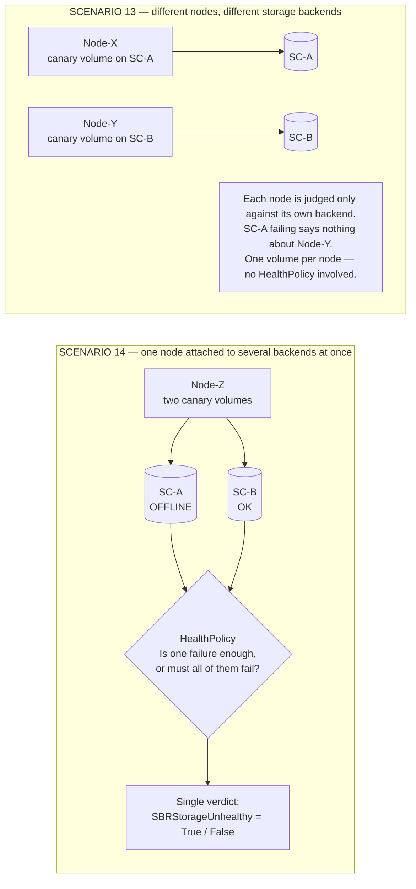
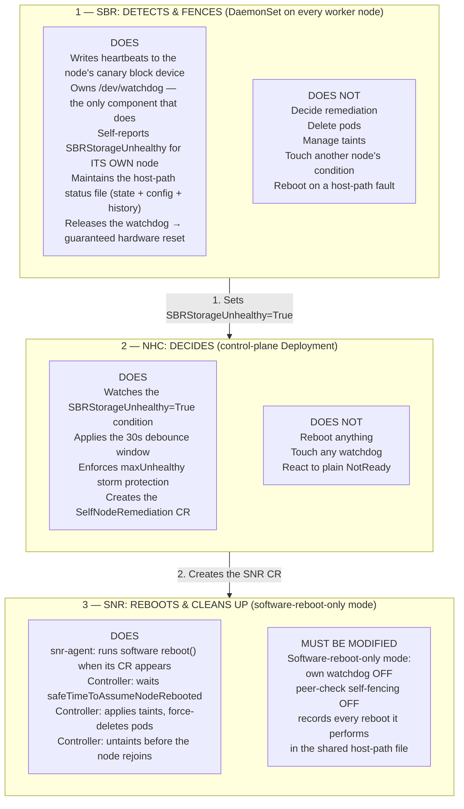
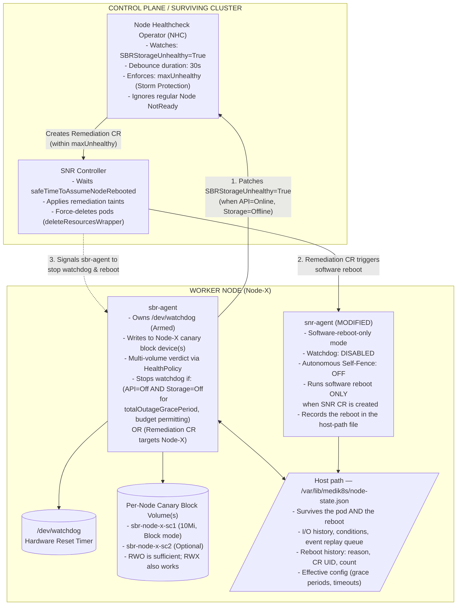
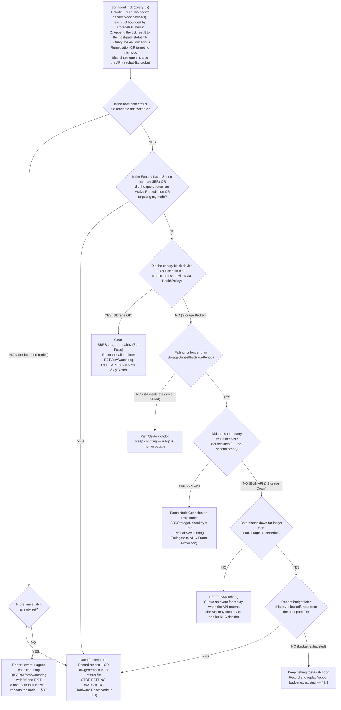
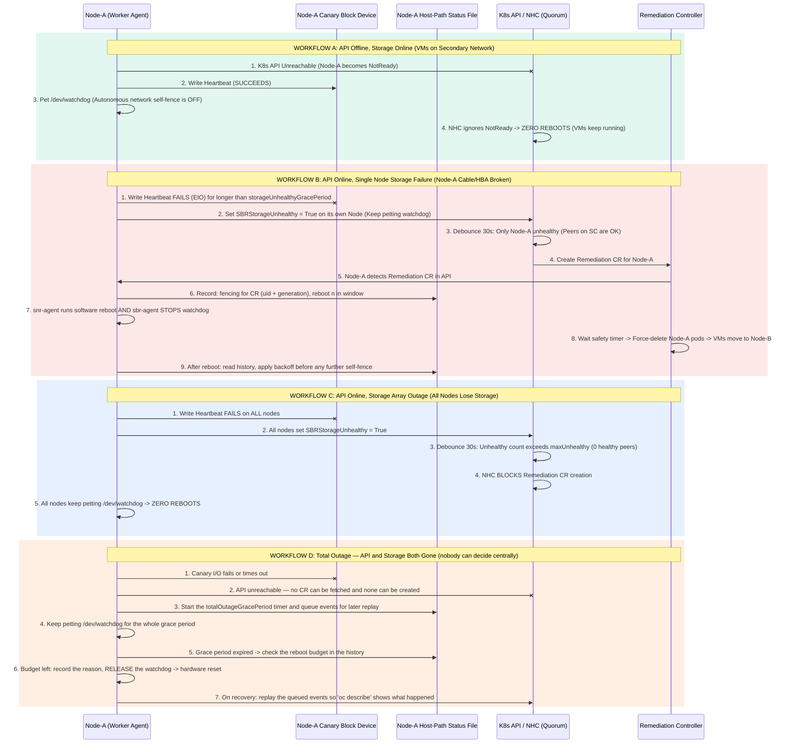
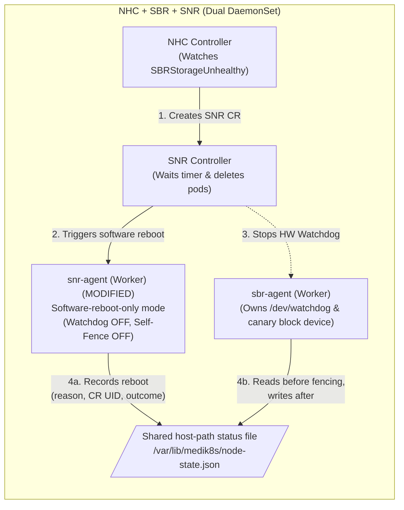
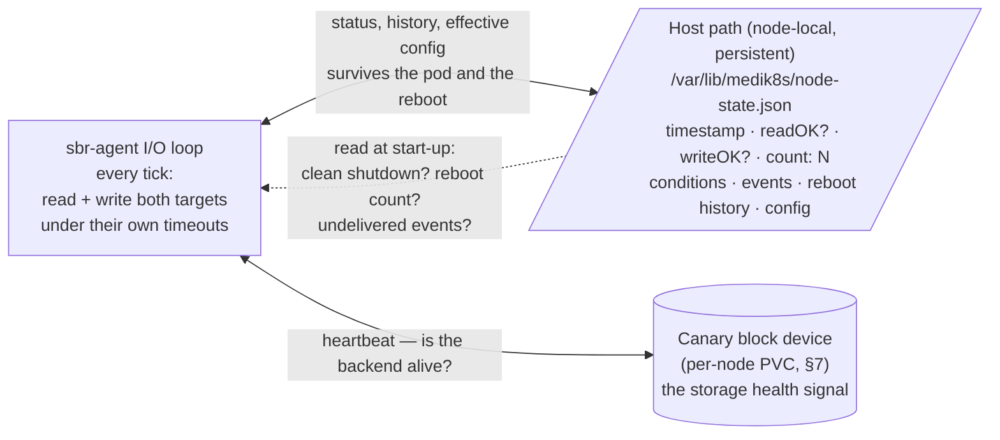
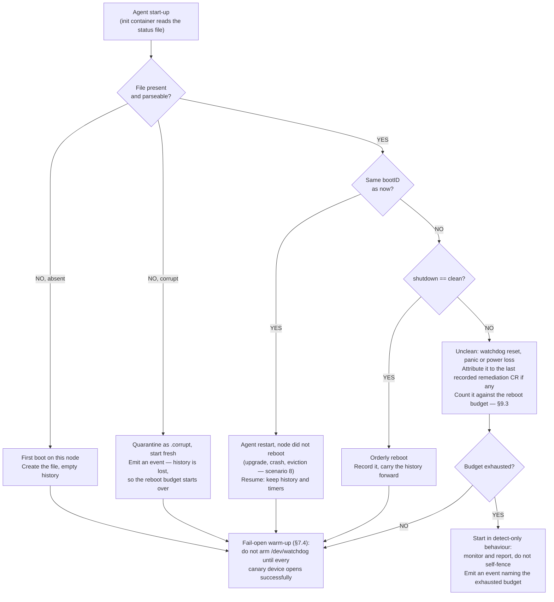

# Storage-Arbitrated Remediation for OpenShift Virtualization

**A storage-aware node remediation stack — NHC + SBR + SNR — that works across every certified CSI block driver, keeps virtual machines running through API and network outages, and reboots a node only when storage arbitration proves it is genuinely unsafe to leave it alone.**

| | |
|---|---|
| **Status** | Proposal — for review |
| **Target release** | 5.9.0 |
| **Tracking** | `RHWA-1839` · `RHWA-1837` · `RFE-9581` |

### Contributors

This proposal came out of several rounds of design discussion and requirements review by:

Daniel Froehlich ([@DanielFroehlich](https://github.com/DanielFroehlich)) ·
Wesley Hayutin ([@weshayutin](https://github.com/weshayutin)) ·
Pranav Gaikwad ([@pranavgaikwad](https://github.com/pranavgaikwad)) ·
Michal Pryc ([@mpryc](https://github.com/mpryc))

### Contents

1. [Complete 17-scenario verification matrix](#1-complete-17-scenario-verification-matrix)
2. [Executive summary](#2-executive-summary)
3. [Why the earlier proposals needed adjustment](#3-why-the-earlier-proposals-needed-adjustment)
4. [System architecture and decision diagrams](#4-system-architecture-and-decision-diagrams)
5. [Component deployment topology and high availability](#5-component-deployment-topology-and-high-availability)
6. [Reboot orchestration and pod cleanup](#6-reboot-orchestration-and-pod-cleanup)
7. [Per-node volume mechanism](#7-per-node-volume-mechanism) — *implementation decision*
8. [Node-local state: the host-path status file](#8-node-local-state-the-host-path-status-file) — *implementation decision*
9. [Grace periods, timeouts and reboot pacing](#9-grace-periods-timeouts-and-reboot-pacing)

---

## 1. Complete 17-Scenario Verification Matrix

This is the acceptance surface for the design: every failure mode the stack is expected to survive, and the behaviour it must produce. Each row states what the node agent does locally, what the cluster decides centrally, and the resulting outcome for the customer's virtual machines.

**17 scenarios covered** — spanning API outages, storage outages, kernel hangs, upgrades, mixed-storage topologies and faults in the agent's own node-local state.

| Outcome class | Count | Meaning |
|---|---|---|
| 🟢 **No reboot** | 8 | Node keeps feeding the hardware watchdog; VMs are undisturbed. |
| 🟠 **Reboot by design** | 5 | Node is reset — by remediation or by the watchdog — and workloads recover elsewhere. |
| 🔵 **Policy-driven** | 4 | Behaviour depends on configured policy — the `HealthPolicy`, a grace period or the reboot budget — or escalates into another scenario. |

> **ℹ️ Note** — Every row is labelled with its outcome class, so the colour is a convenience and never the only signal.

| # | Scenario | Node state | What the node agent(s) do | What the cluster does (NHC + controller) | Outcome |
|:--:|---|---|---|---|---|
| **1** | **Healthy steady state** | `API = OK`<br>`Storage = OK` | Writes to its canary block device, pets `/dev/watchdog`, holds `SBRStorageUnhealthy=False`. | No action. | 🟢 **No reboot**<br>VMs run normally. |
| **2** | **Cluster-wide API outage** | `API = Offline`<br>`Storage = OK` | Sees `Storage=OK` and keeps petting `/dev/watchdog`. Network self-fencing is disabled. | API is down; NHC cannot create remediation CRs. | 🟢 **No reboot**<br>VMs keep running. |
| **3** | **Cluster-wide storage outage** | `API = OK`<br>`Storage = Offline` | All nodes set `SBRStorageUnhealthy=True`. Because `API=OK`, they keep petting the watchdog unless a CR targets them. | After the debounce window, `maxUnhealthy` and the zero-healthy-peer check block CR creation. | 🟢 **No reboot**<br>Storm protection prevents a mass reboot. |
| **4** | **Total datacenter outage** | `API = Offline`<br>`Storage = Offline` | Sees both planes gone, waits out `totalOutageGracePeriod`, then stops petting `/dev/watchdog`. Reason, CR identity and reboot count are written to the host-path file first — see [§8](#8-node-local-state-the-host-path-status-file). | Both planes are dead; no central decision is possible. | 🟠 **Reboot by design**<br>Nodes reset via hardware watchdog once the grace period expires. An opt-out is an [open question](#94-open-question--skipping-the-reboot-on-a-total-outage). |
| **5** | **Single-node API / OVN-K partition** | `API = Offline`<br>`Storage = OK` | Sees `Storage=OK` on its canary block device and keeps petting `/dev/watchdog`. | Node is `NotReady`, but NHC watches only `SBRStorageUnhealthy=True`. | 🟢 **No reboot**<br>VMs on dedicated networks stay up. |
| **6** | **Single-node storage failure** | `API = OK`<br>`Storage = Offline` | After `storageUnhealthyGracePeriod`, sets `SBRStorageUnhealthy=True` **on its own node only**. When the CR appears, runs the software reboot *and* stops the watchdog, recording the CR `UID`/`generation` in the host-path file so the reboot is attributable and not repeated. | NHC creates a remediation CR; the controller waits out the safety timer, then force-deletes pods on the node. | 🟠 **Reboot by design**<br>Node reboots; VMs fail over. |
| **7** | **Kernel panic / freeze / power loss** | Node frozen or dead | `sbr-agent` is frozen or gone, so the watchdog is no longer fed — hardware reset within 60s. | **5.9.0:** recovers post-reboot. **Post-5.9.0 peer inspection is not available** with the chosen volume mechanism — see [§7](#7-per-node-volume-mechanism). | 🟠 **Reboot by design**<br>Hardware watchdog recovers the hung host. |
| **8** | **`sbr-agent` upgrade or restart** | `API = OK`<br>`Storage = OK` | On `SIGTERM` writes the magic close character (`'V'`) to `/dev/watchdog`, disarming the timer across the restart, and records a **clean-shutdown marker** in the host-path file. The next start reads that marker to tell an orderly restart from a watchdog reset. | No action. | 🟢 **No reboot**<br>No false reboots during upgrades. Requires the fail-open warm-up in [§7](#7-per-node-volume-mechanism). |
| **9** | **"Zombie kubelet" (kubelet hung)** | `API = OK`<br>`Storage = OK` | `sbr-agent` sees `Storage=OK` and keeps petting `/dev/watchdog`. | Node is `NotReady`, but `SBRStorageUnhealthy` remains `False`. | 🟢 **No reboot**<br>Running VMs are undisturbed. |
| **10** | **Slow / hanging storage (`D-state`)** | `API = OK`<br>`Storage hung > storageIOTimeout` | Every canary read and write runs in a separate goroutine under `storageIOTimeout`; an expired I/O counts as a failure, and sustained failure past `storageUnhealthyGracePeriod` is treated as `Storage=Offline`. | Resolves into scenario 3 (storm-protected) or scenario 6 (single node). | 🔵 **Policy-driven**<br>Hung I/O never starves the watchdog loop; a short blip never trips remediation. |
| **11** | **Split-brain network partition** | `API = Offline`<br>`Storage = OK` | Minority nodes keep petting `/dev/watchdog` while storage stays healthy. | NHC does not delete pods or move VMs unless storage is unhealthy or revoked. | 🟢 **No reboot**<br>Zero split-brain. |
| **12** | **Last-second network recovery** | Remediation CR active | **Point-of-no-return latch:** once fenced, the agent never resumes petting the watchdog. | Controller waits out the full reboot timer before deleting pods. | 🟠 **Reboot by design**<br>Zero race condition. |
| **13** | **Different nodes, different storage**<br>*one volume each, but not the same backend* | `Node-X → SC-A only`<br>`Node-Y → SC-B only` | Each node attaches a canary volume from *its own* `StorageClass`. `Node-X` never reads or depends on `Node-Y`'s storage. | Health is judged per node, against that node's own backend. A failure of `SC-A` says nothing about `Node-Y`. | 🔵 **Policy-driven**<br>Mixed-backend clusters work; one node's outage never implicates another. **Deferred past 5.9.0** — see [§7](#7-per-node-volume-mechanism). |
| **14** | **One node, several storage backends**<br>*a single node attached to two at once* | `Node-Z → SC-A = Offline`<br>`Node-Z → SC-B = OK` | Monitors every canary device the node owns and evaluates the results against the configured `HealthPolicy`. | NHC acts on the single `SBRStorageUnhealthy` condition the policy produced. | 🔵 **Policy-driven**<br>`HealthPolicy` defines which combination of failures warrants a reboot. **Deferred past 5.9.0** — see [§7](#7-per-node-volume-mechanism). |
| **15** | **Un-evictable / stuck terminating pod** | Remediation triggered | Node reboots via software reboot plus release of the SBR hardware watchdog. | Controller applies the taint and force-deletes pods (`GracePeriod=0`) before untainting. | 🟠 **Reboot by design**<br>Stuck pod is deleted before the node rejoins. |
| **16** | **Host-path status file unwritable**<br>*full root filesystem, read-only remount, local disk fault* | `API = OK`<br>`Storage = OK`<br>`Host path = EIO / RO` | Retries the open and the write with backoff. If the path stays unusable the agent **disarms `/dev/watchdog` with `'V'`, reports, and exits** — a fault in the agent's own bookkeeping must never be charged to the workloads. The DaemonSet restart loop and the agent's `Ready` condition make the degradation visible. If a fence is *already* latched, the reset proceeds regardless. | Node is `Ready` and `SBRStorageUnhealthy` stays `False`, so NHC does nothing. Fencing coverage for this node is lost until the host path is repaired — this is deliberately a loud, non-destructive failure. | 🟢 **No reboot**<br>A local agent or disk fault never reboots a node — see [§8.5](#85-host-path-faults-never-reboot-the-node). |
| **17** | **Repeated remediation of the same node**<br>*reboot loop on a persistently broken backend* | Node rebooted *N* times inside the backoff window | On start the agent replays the reboot history in the host-path file. Each successive self-fence is delayed by an exponential backoff; once the budget in the window is spent the agent stops self-fencing, keeps petting the watchdog, and emits an event naming the exhausted budget. | NHC keeps seeing `SBRStorageUnhealthy=True` and may keep creating CRs; the **node-local** budget — not the API — is what breaks the loop. | 🔵 **Policy-driven**<br>Backoff and budget are configured; a node that cannot be fixed by rebooting stops being rebooted — see [§9.3](#93-reboot-pacing-and-loop-protection). |

### Scope for 5.9.0

The matrix above is the full behavioural target. Not all of it lands in one release.

**In scope for 5.9.0**

- **Per-node canary volumes.** Each node exercises a block volume of its own rather than writing into
  a slot in one volume shared by the whole cluster. This is the change that makes the stack work on
  backends that block concurrent writes or offer only `ReadWriteOnce`.
- **A single `StorageClass`**, cluster-wide. Every node's canary comes from the same backend.
- **Both arbitration models ship.** Existing deployments keep the shared-volume behaviour they have
  today, unchanged and unaffected by upgrade. New deployments get per-node volumes. The model is
  selectable per deployment, so adopting the new one is a deliberate act.
- **Scenarios 1–12 and 15–17**, as described in the matrix.
- **The SNR change** in [§6](#6-reboot-orchestration-and-pod-cleanup) — the software-reboot-only mode.
  It lives in another repository and gates scenarios 6 and 15.
- **The host-path status file** in [§8](#8-node-local-state-the-host-path-status-file): node-local, API-independent
  state and effective configuration, shared with SNR, carrying the reboot history that scenario 17 depends on.
- **Configurable grace periods and I/O timeouts** in [§9](#9-grace-periods-timeouts-and-reboot-pacing), plus the
  exponential reboot backoff.

**Out of scope for 5.9.0**

- **Scenario 13** — different `StorageClasses` on different nodes.
- **Scenario 14** — several `StorageClasses` on a single node, and the `HealthPolicy` that would
  arbitrate between them. Deferred as a scope decision, not a technical barrier.
- **Scenario 7's peer inspection** — a surviving node attaching a dead node's volume to read its last
  heartbeat. This one is **dropped rather than deferred**; see [§7](#7-per-node-volume-mechanism) for
  why, and note the node is still recovered by the hardware watchdog regardless.
- **Retiring the shared-volume model.** It remains supported; there is no forced migration.
- **A partial opt-out from self-fencing on a total outage** — see the
  [open question](#94-open-question--skipping-the-reboot-on-a-total-outage). The existing
  `detectOnlyMode` already provides an all-or-nothing opt-out; the narrower one is not designed yet.
- **A generalised "rebooter" interface** that would let SBR fence on arbitrary unhealthy conditions
  rather than storage ones. Discussed and **rejected** — see [§6](#6-reboot-orchestration-and-pod-cleanup).

### Reading scenarios 13 and 14: two different questions

These two rows are often confused because both mention several `StorageClasses`. They are asking different things. **Scenario 13 is about the cluster** — nodes do not all have to use the same storage backend, and each node is judged only against its own. **Scenario 14 is about a single node** — one node attached to two backends at once, where something has to decide whether losing one of them is grounds for a reboot. That decision is the `HealthPolicy`.

**Diagram 1 — Scenario 13 vs. scenario 14: per-node storage, and per-node *policy***



> ### 🔑 `HealthPolicy` — the knob that decides when storage loss means "reboot"
>
> *Design for the multi-backend work. **Not in 5.9.0**, which ships a single `StorageClass` per node — see [§7](#7-per-node-volume-mechanism).*
>
> A node with more than one canary volume needs a rule for turning several device results into the one `SBRStorageUnhealthy` condition NHC watches. `HealthPolicy` is that rule — for example *"any one backend failing marks the node unhealthy"* (safest for VMs whose disks could be on either backend) versus *"all backends must fail"* (avoids rebooting a node that can still serve some of its workloads). It is deliberately a policy rather than hard-coded behaviour, because the right answer depends on how the customer spreads VM disks across their storage.

---

## 2. Executive Summary

OpenShift Virtualization (KubeVirt) requires a storage-aware remediation stack that works across **all** certified CSI block drivers — including backends that block concurrent writes (for example Portworx) or support only `ReadWriteOnce` (`RWO`) — while respecting Node Healthcheck Operator (NHC) storm protection (`maxUnhealthy`) and avoiding unnecessary VM disruption during Kubernetes API or OVN-Kubernetes network outages.

> ### ✅ What this buys the customer
>
> A node is rebooted only when the design can prove it is unsafe to leave running. Network trouble alone never costs a VM outage; a cluster-wide storage blip never cascades into a cluster-wide reboot; and a genuinely dead or hung host is always recovered by hardware, not hope.

### Core architectural pillars

**1. Per-node canary block volumes**

Each node mounts its own dedicated, lightweight 10 Mi block-mode PVC. 5.9.0 ships one `StorageClass` per node; extending to several, with a `HealthPolicy` deciding the verdict, is designed for but deferred. How that per-node volume is bound to the agent pod is an implementation decision — see [§7](#7-per-node-volume-mechanism). `ReadWriteOnce` is sufficient — the volume is never shared — but a `ReadWriteMany` backend works just as well, because all SBR needs is a writable block device. One mount per node — `O(1)` — eliminates concurrent-writer locks, cross-node `O_DIRECT` page-cache bugs and on-disk `NodeMap` contention.

**2. SBR owns `/dev/watchdog`, with a dual-path guard**

`sbr-agent` continuously evaluates both local storage health and K8s API reachability. It self-fences autonomously only when **both** storage and API are lost (or on a kernel hang), and otherwise delegates the decision to NHC while the API is reachable.

**3. Zero-reboot storage-array outage protection**

When a storage array suffers a cluster-wide blip while the K8s API is online, nodes self-report `SBRStorageUnhealthy=True` and NHC enforces storm protection plus a healthy-peer check — preventing cascading cluster-wide reboots.

**4. Reboot orchestration and pod cleanup**

When NHC triggers remediation the target node is reset, backed by the hardware watchdog. Once the calculated safety timer expires, stuck pods are force-deleted through SNR's `deleteResourcesWrapper`, so workloads can safely restart elsewhere.

**5. Node-local state that outlives the API and the pod**

Every decision the agent makes — each I/O result, each condition change, each reboot and the reason for it, plus the effective configuration — is appended to a small JSON file on a host path, shared with SNR. Fencing decisions must be possible when the API is unreachable, and the record of them must survive the pod that made them. This is what makes the reboot budget, the attribution of a reboot to a specific remediation CR, and post-mortem over SSH possible at all — see [§8](#8-node-local-state-the-host-path-status-file).

**6. Everything is on a timer the administrator controls**

Storage I/O is bounded, a short storage blip is not an outage, and a total outage does not mean an instant reset. Distinct, configurable grace periods separate *"storage is slow"* from *"storage is gone"* from *"everything is gone"*, and an exponential backoff keeps a node that cannot be fixed by rebooting from being rebooted forever — see [§9](#9-grace-periods-timeouts-and-reboot-pacing).

---

## 3. Why the Earlier Proposals Needed Adjustment

Three concrete workflows explain why the two original Jira proposals cannot ship as written, and what changes in the combined design to close each gap.

> ### ❌ Gap 1 — RHWA-1839, concurrent-mount RWX block
>
> - **Workflow 1A — 100-node scaling (violates AC #4):** if every node mounts *N−1* peer volumes to read heartbeats, a 100-node cluster hits Linux/CSI LUN attachment limits (32–128 disks per node), leaving no room for KubeVirt VM disks.
> - **Workflow 1B — Portworx single-writer deadlock:** the first node to open a volume for writing holds an exclusive lock. If `Node-A` loses API access while its storage path is still up, it keeps that lock — and peer `Node-B` blocks forever trying to write a `FENCE` message to `Node-A`'s disk.
> - **Workflow 1C — stale kernel RAM cache:** without coherent cross-node `O_DIRECT`, a peer with a permanent mount reads stale cached sectors from local RAM and false-positive fences a healthy VM host.

> ### ❌ Gap 2 — RHWA-1837 / RFE-9581, NHCControlled mode
>
> - **Workflow 2A — the "broken storage catch-22" split-brain:** this proposal pets `/dev/watchdog` *unconditionally* when storage is unhealthy (`handleWatchdogTickSBRUnhealthy`) and self-fences only when the agent *reads* a fence message from its SBD slot. But when `Node-A`'s storage connection breaks, **`Node-A` cannot read its SBD slot** to see the fence message. It keeps petting its watchdog forever and never reboots — while 60s later the controller sees the stale heartbeat, assumes the node rebooted, and marks remediation `Succeeded`. Split-brain.

> ### 🔧 Three refinements to the combined SBR + SNR workflow
>
> - **Workflow 3A — hung software reboot on broken storage:** when storage is broken, Linux processes such as `qemu-kvm` enter uninterruptible `D-state`, so SNR's software `reboot()` hangs indefinitely.
>   *Fix:* once NHC creates the remediation CR for `Node-A`, `sbr-agent` on that node must *also* stop feeding `/dev/watchdog`, so the hardware watchdog guarantees a reset within 60s.
> - **Workflow 3B — dead node / power-loss failover:** a node that loses power, or loses both API and storage, cannot self-report `SBRStorageUnhealthy=True`.
>   *Fix (originally planned post-5.9.0):* a leader-elected SBR controller on a healthy worker peer would mount the `NotReady` node's canary block device on demand, see the stale timestamp, and set `SBRStorageUnhealthy=True` on that node's behalf. **This is no longer available** — the chosen volume mechanism does not preserve a dead node's volume, see [§7](#7-per-node-volume-mechanism). The node is still recovered: the hardware watchdog resets it regardless.
> - **Workflow 3C — everything interesting happens while nobody is watching:** the agent's most important decisions are taken in exactly the states where it cannot record them. CR status and node conditions need the API, which is down. Container logs live in the pod, which the reboot destroys. An administrator who SSHes into a node that reset itself overnight has nothing to read, and the agent that comes back up has no idea it is the third reboot in ten minutes.
>   *Fix:* persist the decision record and the effective configuration to a host path that survives both the pod and the reboot, and replay the missed events into the API when it returns — see [§8](#8-node-local-state-the-host-path-status-file).

---

## 4. System Architecture and Decision Diagrams

Five views of the same system: who is responsible for what, what runs where, how a single node decides each tick, how the cluster arbitrates across the key failure workflows, and how the two agents divide the reboot.

### Who is responsible for what

The three operators have strictly separate jobs, and the split matters: **NHC decides** whether a node should be remediated, **SBR detects and fences** using the hardware watchdog, and **SNR performs the reboot and cleans up the workloads**. No component does two of those jobs, and exactly one component owns `/dev/watchdog`.

**Diagram 2 — Division of responsibilities: NHC decides, SBR detects and fences, SNR reboots and cleans up**



> ### 🔒 Invariant — a node's condition is written by that node, and by nothing else
>
> `SBRStorageUnhealthy` is set **only** by the `sbr-agent` running on the node it describes. No controller, no peer and no leader writes it on another node's behalf. The condition therefore means exactly one thing — *"the agent on this node observed its own storage failing"* — and never *"somebody else inferred something about this node."*
>
> This follows the loss of peer inspection in [§7.4](#74-what-this-costs) and is a simplification rather than a regression: a node that is dead cannot report, but it also cannot be left running, because the hardware watchdog resets it. The condition is the storage signal; `NotReady` remains the liveness signal, and NHC is deliberately configured to act on the former.

> ### 🚨 Required change — SNR must gain a software-reboot-only mode
>
> SNR cannot be adopted as-is. Today it arms its own watchdog and can self-fence autonomously after a peer check; in this design **SBR owns `/dev/watchdog` exclusively** and NHC is the only thing allowed to decide that a node should go. SNR therefore needs a configuration mode in which both its watchdog and its peer-check self-fencing are switched off, leaving it responsible for exactly two things: running the software `reboot()` when its CR appears, and performing the timer-gated pod cleanup afterwards. Two components arming watchdogs independently would reintroduce the very split-brain this architecture removes.
>
> A second, smaller change comes with it: **SNR records every reboot it performs in the shared host-path status file**, through the same common function SBR uses ([§8.6](#86-one-file-two-operators)). Without it the two operators can each conclude, independently and correctly, that this node has not been rebooted yet. **These are the upstream changes the proposal depends on.**

### Component architecture

**Diagram 3 — Component architecture: NHC + SBR + SNR**



### Local node decision flow

**Diagram 4 — Local node watchdog decision flow: `sbr-agent`, every 5s tick (one API query per tick)**



> ### 🔍 Why one query serves both checks — and why the branch still has to exist
>
> Looking for a Remediation CR *is* an API reachability test, so the agent makes a single call per tick rather than probing the API twice. What the flow must never do is collapse the two possible "no CR" answers into one: **"the API answered, and there is no CR"** is a completely different state from **"the agent could not reach the API at all."**
>
> If those were treated the same, a node that lost both its storage and its API would see no CR, see a failed disk write, and carry on petting `/dev/watchdog` forever — which is precisely the split-brain described in Gap 2 and the failure that scenario 4 exists to catch. The query therefore returns three states (*CR found* / *answered, no CR* / *unreachable*), and the branch at `F` simply reads the third one. In implementation this must come from the actual call result, not from a cached informer read — a stale cache will happily answer "no CR" on a node whose network is already gone.

### Cluster-level arbitration

**Diagram 5 — How the quorum / NHC decides across the key failure workflows**



---

## 5. Component Deployment Topology and High Availability

Where each component runs, and what happens if the node hosting a controller dies.

| Component | DaemonSet on every worker node? | Central controller (Deployment)? | Role and high-availability behaviour |
|---|---|---|---|
| **SBR**<br>`sbr-agent` and controller | **Yes**<br>one pod per worker node | **Yes**<br>operator + leader-elected reconciler inside `sbr-agent` | **Per-node agent role:** mounts the node's canary block device(s), owns `/dev/watchdog`, writes heartbeats every 5s and **self-reports `SBRStorageUnhealthy=True` directly to the K8s API** when storage fails while the API is up — no central controller is required to report it.<br><br>**Leader-elected peer role:** every `sbr-agent` pod participates in Kubernetes `Lease` leader election. If the current leader node dies, another healthy worker's agent wins the lease within ~15s — crucial because worker nodes, not control-plane nodes, have access to VM SAN/CSI storage.<br><br>**Node-local state:** maintains the host-path status file ([§8](#8-node-local-state-the-host-path-status-file)) — the only part of the stack that keeps working, and keeps a record, with the API down. |
| **NHC**<br>Node Healthcheck Operator | **No**<br>never runs as a DaemonSet | **Yes**<br>control-plane Deployment with leader election | **The decision maker and storm protector:** watches `Node` conditions (`SBRStorageUnhealthy=True`) in the K8s API.<br><br>Applies the 30s debounce window and `maxUnhealthy` storm protection before creating the `SelfNodeRemediation` CR. |
| **SNR**<br>Self Node Remediation<br>*(requires the software-reboot-only mode)* | **Yes** | **Yes** | **Worker role (`snr-agent`):** runs in **software-reboot-only mode** — its own watchdog and peer-check self-fencing are switched off — and sits idle until an `SNR` CR is created for its node, at which point it triggers the software `reboot()`. This mode does not exist upstream today and must be added.<br><br>**Controller role:** waits out `safeTimeToAssumeNodeRebooted`, manages taints and force-deletes pods via `deleteResourcesWrapper`.<br><br>**Shared-state role (new):** every reboot SNR performs is written to the same host-path status file through the common library, so SBR and SNR agree on what has already been done to this node. |

---

## 6. Reboot Orchestration and Pod Cleanup

The proposed approach reuses SNR's proven reboot-timer and pod-deletion controller rather than re-implementing it inside SBR.

### Combined NHC + SBR + SNR (Pranav Gaikwad's proposal)

**How it works**
NHC creates a `SelfNodeRemediation` (SNR) CR when `SBRStorageUnhealthy=True`.

**On the worker node**
Two DaemonSet pods run per node — `sbr-agent`, which owns `/dev/watchdog` and the canary block device, and `snr-agent`, which has watchdog and self-fencing disabled and runs the software `reboot()` when the SNR CR appears, while `sbr-agent` stops feeding `/dev/watchdog`.

**Workload cleanup**
Handled by the existing `SNR Controller` through `deleteResourcesWrapper`.

**✅ Advantage**
Reuses SNR's existing pod-deletion and reboot-timer controller logic without porting it to SBR.

**⚠️ Trade-off**
Requires modifying SNR to add a `watchdogDisabled` / `selfFencingDisabled` mode and to write its reboot outcomes to the shared host-path file, and runs two DaemonSets and two controllers on every cluster.

**Diagram 6 — Dual agent: SBR + SNR responsibilities during remediation**



### The shared file is what keeps the two operators from fighting

Both operators can reboot this node, and both decide locally. The failure that follows is not hypothetical: SNR performs the software reboot for CR `X`, the node comes back, `sbr-agent` starts fresh with an empty memory, sees storage still broken and a CR it has never seen before, and fences the node again for the same remediation. Or the reverse — the watchdog resets the node while SNR is mid-`reboot()`, and the controller's safety timer is measuring something that already happened.

The fix is to make "has this node already been rebooted, by whom, for which CR?" a question with an answer that **survives the reboot**. Both operators write it to the same file through the same function, keyed by the remediation CR's `UID` and `generation`:

- Before self-fencing, `sbr-agent` checks whether a reboot for this CR `UID`/`generation` is already recorded. If SNR's software reboot has done the job, there is nothing left to escalate.
- Before counting a reboot against the budget ([§9.3](#93-reboot-pacing-and-loop-protection)), each operator checks whether the other already counted it. One remediation is one reboot, however it was carried out.
- After a reboot, the record explains *which* CR caused it — the detail an administrator cannot otherwise recover once the pod and its logs are gone.

> ### 🚫 Rejected — a generalised "rebooter" interface
>
> An obvious generalisation suggests itself: SBR owns the watchdog, so let it fence on *any* unhealthy condition and let other remediators plug in. It was discussed and rejected. The customers driving this work care about storage health specifically and explicitly do not want `NotReady` to cost them a VM, and a plug-in fencing interface would have to answer, for every combination of conditions, which signals may release the watchdog — an arbitration problem considerably larger than the one being solved.
>
> SBR stays a **storage** arbitrator. If another remediator later needs the watchdog, the shared host-path file is the natural coordination point, and that is the point at which the question deserves a fresh design rather than a pre-built abstraction.

---

## 7. Per-node volume mechanism

*Implementation decision. Recorded here because it constrains two scenarios in [§1](#1-complete-17-scenario-verification-matrix).*

### 7.1 The constraint

Every node needs its **own** canary volume. Kubernetes offers no way for a single DaemonSet to name a
different PVC per node:

- `PersistentVolumeClaimVolumeSource` is `{claimName, readOnly}` — there is no templating, so a pod
  spec cannot say *"the PVC belonging to whichever node I land on"*.
- `DaemonSetSpec` has no `volumeClaimTemplates` field; only `StatefulSetSpec` does.

Note this is a problem of **per-node identity**, not of StorageClass count. It exists even with a
single `StorageClass`.

### 7.2 Decision — generic ephemeral volumes

The agent DaemonSet declares one `ephemeral.volumeClaimTemplate` per configured backend. Kubernetes
creates a PVC per pod, binds it, and deletes it with the pod.

```yaml
volumes:
  - name: canary-backend-0
    ephemeral:
      volumeClaimTemplate:
        spec:
          accessModes: ["ReadWriteOnce"]
          volumeMode: Block
          storageClassName: <backend>
          resources: { requests: { storage: 10Mi } }
```

Chosen because it keeps the DaemonSet — node add/remove, rolling upgrades and pinning all stay the
platform's job rather than ours — and because disposable volumes make later storage-topology changes
cheap. The alternatives considered were a pinned single-replica StatefulSet per node (stable volumes,
but *N* workloads to reconcile and immutable `volumeClaimTemplates`) and a mutating pod webhook that
rewrites `claimName` per node (rejected: it places a webhook in the critical path of fencing-agent
startup).

### 7.3 Mount definition — one path, one mode, no special cases

The agent today carries two parallel notions of "where the storage is": a filesystem path for filesystem
mode and a device path for block mode, each with its own plumbing. With per-node canary volumes the
distinction gets a third consumer (the host path of [§8](#8-node-local-state-the-host-path-status-file),
which is *always* a filesystem), and three ad-hoc paths is one too many.

The storage targets are therefore described uniformly — **a path plus a volume mode** — and the mode
alone decides how the path is realised in the pod spec:

| Target | Mode | Realised as | Lives in |
|---|---|---|---|
| Canary volume (`Block`) | `Block` | `volumeDevices[].devicePath` | ephemeral PVC, per pod |
| Canary volume (`Filesystem`) | `Filesystem` | `volumeMounts[].mountPath` | ephemeral PVC, per pod |
| Node status file | `Filesystem` | `volumeMounts[].mountPath` | `hostPath`, per node |
| Watchdog device | *(device)* | `hostPath` directory mount | per node |

Two consequences worth stating, because both are current sources of bugs: the block device path must
never fall under a `hostPath` mount — a bind mount at `/dev` makes the runtime skip the CSI-mapped
device node, which is why block mode mounts the watchdog's *parent* directory at `/host-dev` rather
than all of `/dev` — and the host status path must be a real, persistent filesystem, never `tmpfs`
([§8.2](#82-where-the-file-lives)). Validating "is this path usable, in this mode?" becomes one code
path instead of one per mode.

### 7.4 What this costs

**Peer inspection is not possible (scenario 7).** An ephemeral PVC is owned by its pod and is garbage
collected with it. When a node dies and its pod is removed, the volume is deleted, so there is nothing
for a surviving node to attach and inspect. This is a property of the volume type, not a gap to be
closed later; the post-5.9.0 half of scenario 7 is **dropped**, not deferred. Detection of a dead node
is unaffected — the hardware watchdog still resets it, and NHC still acts on the node's last reported
condition.

**All multi-backend work is deferred past 5.9.0 (scenarios 13 and 14).** 5.9.0 ships a **single
`StorageClass`**, selected by a new mode field on the config CR, so each node keeps exactly one canary
volume. `NodeStorageClasses` and `HealthPolicy` are not part of 5.9.0 — they only earn their keep once a
node can have more than one backend. The two scenarios are deferred for different reasons:

- **Scenario 14** (several backends on one node) is purely a scope decision. Ephemeral volumes support
  it directly — one `ephemeral` entry per backend, each with its own `storageClassName`, with
  `HealthPolicy` combining the per-device results. Adding it later is an extra volume entry and an
  extra flag, with no architectural change.
- **Scenario 13** (different backends on different nodes) is additionally constrained by the DaemonSet:
  one pod template means every node is offered the same storage. The route, when needed, is one
  DaemonSet per StorageClass-group, derived by the controller — typically a handful, not one per node.

Neither needs this volume decision revisited, and neither involves migrating a volume, because the
canaries are disposable.

**Volumes are reprovisioned on pod recreation (scenario 8).** A new PVC is created per *pod*, not per
container start: a crash-looping agent keeps its volume, but a rollout, eviction or node reboot
provisions a fresh one. The agent must therefore **fail open on start-up** — it does not arm or pet
`/dev/watchdog` until every canary device opens successfully, so that attach latency is never mistaken
for a storage failure. Attach latency should be measured on each target backend, since it sets the
blind window during an upgrade.

**Volume names are pod-derived.** The PVC is named `<pod-name>-<volume-name>`, and DaemonSet pod names
carry a random suffix, so there is no stable `sbr-node-<name>` identifier. The operator exposes a
node → PVC mapping in status so an operator can still answer *"which volume belongs to this node?"*.
Diagram 3's volume labels are illustrative rather than literal.

### 7.5 What this does not cost

**Multi-backend support is not foreclosed.** Deferring scenarios 13 and 14 is a scope decision for
5.9.0, not a consequence of choosing ephemeral volumes — see §7.4 for how each is added later.

**Access modes are unchanged.** `ReadWriteOnce` remains sufficient because the volume is never shared;
a `ReadWriteMany` block backend works equally well.

### 7.6 Revisiting

The decision turns on a single question: whether a surviving node must be able to inspect a dead
node's volume. If that requirement returns, the volume model has to move to stable per-node PVCs
(pinned StatefulSets), which is a migration of a fencing component's workload model and would need a
planned transition rather than an in-place upgrade. Multi-StorageClass support, in either form, does
**not** require revisiting this decision.

---

## 8. Node-local State: the Host-Path Status File

*Implementation decision. It closes workflow 3C in [§3](#3-why-the-earlier-proposals-needed-adjustment) and is what scenarios 16 and 17 are built on.*

### 8.1 Why a file on the host at all

A fencing agent is at its most interesting precisely when nothing is watching. Three concrete gaps follow from that, and one mechanism closes all three:

1. **The API is unreachable exactly when the decision is made.** Node conditions and CR status cannot be written during an outage, so the one decision an administrator most wants explained — *why did this node reset itself at 03:14?* — is the one the cluster has no record of.
2. **The pod does not survive the reboot it causes.** Container logs die with the pod. The agent that comes back has no memory of the agent that went away, which is how reboot loops are born: without node-local history, "is this my third reset in ten minutes?" is unanswerable, and the API cannot be trusted to answer it either, since the API may be the thing that is down.
3. **Configuration has to be readable with the API down.** An agent that must decide whether to release the watchdog after *N* seconds cannot fetch *N* from a CR it cannot reach.

So `sbr-agent` keeps a small JSON file on a host path, written on the same cadence as the canary I/O, and reads it back at start-up. The agent already has a storage write loop; the host path becomes its second target rather than a second process.

**Diagram 7 — The agent's two write paths: shared canary device and node-local status file**



The two targets answer different questions and must not be confused. **The canary device answers "is the storage backend alive?"** and a failure there is a cluster-relevant fact that can justify fencing. **The host path answers "what has this node been doing?"** and a failure there is a local fault that justifies nothing — see [§8.5](#85-host-path-faults-never-reboot-the-node).

### 8.2 Where the file lives

| Property | Value | Why |
|---|---|---|
| Path | `/var/lib/medik8s/node-state.json` | Shared across medik8s node agents, not SBR-private — SNR writes here too ([§8.6](#86-one-file-two-operators)). Configurable, but the *same* value must be configured for both operators. |
| Mount | `hostPath` directory, `type: DirectoryOrCreate` | The agent is already privileged and already mounts host paths for `/dev`, `/proc` and `/sys`. |
| Filesystem | Must be persistent and writable; **never `tmpfs`** | Reboot history that does not survive the reboot cannot break a reboot loop. Validated at start-up and reported, not assumed. |
| Size ceiling | 1 MiB, enforced by rotation ([§8.4](#84-rotation--keeping-the-file-small)) | A fencing agent must never be the reason `/var` fills up. |
| Write protocol | `flock`, write to a temporary file, `fsync`, `rename` | Two writers, and a reader that may be a human with `cat` during an outage. A half-written status file must never be observable. |

### 8.3 What the file contains

One document per node, versioned so the format can change without the next agent misreading the previous one's output:

```jsonc
{
  "schemaVersion": 1,
  "node": "worker-3",
  "bootID": "4f2c…",                 // /proc/sys/kernel/random/boot_id — detects "we rebooted"
  "updatedAt": "2026-10-27T03:14:07Z",

  "agents": {                        // one entry per medik8s agent on this node
    "sbr": { "version": "5.9.0", "startedAt": "…", "watchdogArmed": true, "shutdown": "unclean" },
    "snr": { "version": "…",     "startedAt": "…", "watchdogArmed": false, "shutdown": "clean" }
  },

  "config": {                        // effective config, so the agent can act with the API down
    "storageIOTimeout": "15s",
    "storageUnhealthyGracePeriod": "15s",
    "totalOutageGracePeriod": "60s",
    "rebootBackoff": { "initial": "5m", "max": "2h", "resetAfter": "24h" },
    "maxRebootsPerWindow": 3,
    "detectOnlyMode": false,
    "source": "StorageBasedRemediationConfig/cluster@generation-7"
  },

  "io": [                            // rotated ring — the "Read OK? / Write OK? / Count: N" record
    { "ts": "…", "target": "canary",   "read": "ok",      "write": "ok",   "latencyMs": 3,     "count": 184213 },
    { "ts": "…", "target": "canary",   "read": "timeout", "write": "eio",  "latencyMs": 15000, "count": 184214 },
    { "ts": "…", "target": "hostpath", "read": "ok",      "write": "ok",   "latencyMs": 1,     "count": 184214 }
  ],

  "conditions": [                    // what we published, or wanted to
    { "ts": "…", "type": "SBRStorageUnhealthy", "status": "True", "published": false, "reason": "APIUnreachable" }
  ],

  "events": [                        // replay queue — see §8.8
    { "ts": "…", "reason": "APIOffline",     "message": "API unreachable; storage OK; still petting", "delivered": false },
    { "ts": "…", "reason": "WatchdogReleased", "message": "totalOutageGracePeriod 60s expired",        "delivered": false }
  ],

  "reboots": [                       // the budget in §9.3 is computed from this
    {
      "ts": "2026-10-27T03:14:07Z",
      "source": "sbr",               // or "snr"
      "method": "watchdog",          // or "software"
      "reason": "TotalOutage",       // or "RemediationCR" | "StorageUnhealthy"
      "remediation": { "kind": "SelfNodeRemediation", "name": "worker-3", "uid": "9c1b…", "generation": 2 },
      "nhc": { "name": "nhc-storage", "uid": "7a0e…" },
      "completed": true
    }
  ]
}
```

Three details carry weight. **`bootID`** is how the agent knows it is looking at a previous boot's record rather than its own. **`remediation.uid` and `generation`** are how a reboot is attributed to the CR that caused it — the same identity is mirrored onto the node as an annotation when the API is available, so the mapping is visible from `oc describe node` as well as from the file. **`config.source`** records which CR generation produced the values in use, so a stale cached configuration is recognisable rather than silently authoritative.

### 8.4 Rotation — keeping the file small

An append-only record on a 5s cadence is roughly 17,000 entries a day. Two limits are enforced together, whichever trims first:

- **`maxEntries`** — a ring of the most recent **100** I/O entries. Bounds the file regardless of cadence or clock weirdness.
- **`maxAge`** — **24h** by default, raisable to a week. Bounds how far back an investigation can reach.

`io` entries are the high-volume ones and are the main target. `reboots` is rotated by age only, and with a longer horizon (default 7 days), because it is the input to the backoff calculation in [§9.3](#93-reboot-pacing-and-loop-protection) — trimming it by count would quietly hand a looping node a fresh budget. Undelivered `events` are never dropped by rotation; they are dropped once delivered, with a separate hard cap to bound a long outage.

> **ℹ️ Note** — The file is a **diagnostic and decision record, not a log sink.** Anything worth keeping beyond a day belongs in the cluster's logging stack. The file exists to answer questions during an outage and immediately after one.

### 8.5 Host-path faults never reboot the node

This is the sharpest rule in this section, and the reason to state it as a rule rather than as error handling.

If a write to `/var/lib/medik8s/node-state.json` fails — a full root filesystem, a read-only remount, a failing local disk — the agent **must not** treat it as a storage failure and **must not** let the watchdog expire. It retries the open and the write with bounded backoff, and if the path stays unusable it:

1. emits an event and logs the error with the underlying `errno`,
2. reports itself degraded on the `StorageBasedRemediationConfig` status,
3. writes `'V'` to `/dev/watchdog` to **disarm** it, and
4. exits, leaving the DaemonSet restart loop and the pod's `Ready` state to make the problem visible.

The asymmetry is deliberate. A canary-device failure is evidence about the *cluster's* storage and can justify taking a node out. A host-path failure is evidence about *this agent's own bookkeeping* — rebooting a node full of healthy VMs because the agent could not write its diary would be the stack causing exactly the outage it exists to prevent. The honest failure mode is "fencing coverage for this node is off until someone fixes the disk", loudly, and the second-honest thing is to make sure the watchdog is disarmed on the way out rather than leaving a timer running behind a dead agent.

> ### ⚠️ One exception — the fence latch outranks everything
>
> If the node has **already** been fenced — the latch is set, because a remediation CR targeted this node or a total outage ran past its grace period — a host-path fault does **not** disarm the watchdog and does **not** stop the reset. The point-of-no-return latch of scenario 12 is absolute: once fencing has begun, the cluster may already be force-deleting this node's pods and starting its VMs elsewhere, and a node that quietly cancelled its own reset at that moment is precisely the split-brain the whole design exists to prevent.
>
> The agent records what it can, logs what it cannot, and lets the watchdog expire. **Disarm-and-exit is the behaviour of an agent that has not yet committed to anything.**

### 8.6 One file, two operators

SNR writes to the same file, through a **common function in `medik8s/common`** rather than its own implementation — one locking and rotation implementation, one schema, one place to fix a bug in either. The reasoning, and the deduplication it enables, is in [§6](#6-reboot-orchestration-and-pod-cleanup); what matters here is the contract:

- **Namespaced by writer.** Each agent owns its own entry under `agents`, and every `reboots` entry names its `source`. Neither operator rewrites the other's records.
- **One lock, short critical sections.** Read-modify-write under `flock`, with a timeout — a lock held by a process stuck in `D-state` must not take the watchdog loop down with it. A lock acquisition that times out is a host-path fault and follows [§8.5](#85-host-path-faults-never-reboot-the-node).
- **Forward compatible.** Unknown fields are preserved on write, so a newer SNR and an older SBR can share the file during a staggered upgrade.

> **⚠️ Cross-repository dependency** — this requires agreement from the SNR maintainers, who have not yet had this proposal put to them. SBR works without it; what degrades is reboot deduplication (both operators may count the same remediation separately) and attribution (a software reboot performed by SNR leaves no node-local trace). Those are the stakes, and they should be stated plainly when the change is proposed upstream.

### 8.7 Start-up: what the previous boot left behind

Before arming anything, the agent reads the file and classifies the previous shutdown. The check runs in an **init container** so that an unreadable or corrupt file is surfaced before the fencing agent starts, and so the result is available to the agent as plain, already-validated state.

**Diagram 8 — Start-up classification**



The `bootID` comparison is what separates scenario 8 (agent restarted, node did not) from scenario 7 (node reset underneath the agent). Without it, every rolling upgrade would look like a reboot and would eat the budget.

### 8.8 Events — telling the story once the API returns

Node conditions cannot be written during an API outage, and a condition only carries the *current* state in any case. The agent therefore records what happened as **Kubernetes events, queued locally and delivered when the API returns**, with the original timestamp preserved in the message so a reader can reconstruct the sequence. An administrator then sees the outage in `oc describe node` / `oc describe sbrconfig` — the place they already look — instead of having to find a pod that no longer exists.

| Event | Emitted when | Delivery |
|---|---|---|
| `APIOffline` / `APIRestored` | The per-tick API probe starts failing, and when it recovers | Queued, replayed |
| `StorageUnhealthy` / `StorageRestored` | `storageUnhealthyGracePeriod` expires, and on recovery | Live if the API is up; queued otherwise |
| `WatchdogReleased` | The agent stops petting, with the reason and the triggering CR | Queued — by definition the API is unreachable or the node is going down |
| `RebootBudgetExhausted` | Self-fencing suppressed by the budget ([§9.3](#93-reboot-pacing-and-loop-protection)) | Queued, replayed |
| `HostPathDegraded` | Status file unwritable after retries ([§8.5](#85-host-path-faults-never-reboot-the-node)) | Live — by definition the API is reachable in this scenario |

Replay is best-effort and bounded: events older than the queue's retention are summarised into one aggregate event rather than replayed individually, so a node returning from a long outage does not flood the API.

### 8.9 Platform requirement — host paths must not be blocked

**The design depends on `hostPath` volumes, and that dependency must be documented as a prerequisite rather than discovered during an incident.**

The agent is already a privileged DaemonSet: it holds `hostPID`, owns `/dev/watchdog` and mounts host directories. The namespace therefore already carries the `privileged` Pod Security Standard label, and a privileged pod may use `hostPath` volumes. The status file adds no new class of permission — it is the same mechanism, pointed at `/var/lib/medik8s` instead of `/dev`.

What it does add is one more thing a cluster policy can switch off. `hostPath` can be denied independently of privilege — by a Pod Security Admission profile on the namespace, or by an admission policy (Gatekeeper, Kyverno, OpenShift SCC) that forbids `hostPath` cluster-wide. Where such a policy exists, SBR cannot run as designed:

- **Prerequisite, to be documented in the install guide:** the SBR namespace must permit privileged pods, `hostPID`, and `hostPath` volumes for the configured status-path directory.
- **Fail loudly, not silently.** The operator validates the host path at start-up and reports a clear condition on `StorageBasedRemediationConfig` when it is unusable, rather than degrading into a fencing agent with no memory.
- **No fallback is offered.** An `emptyDir` or `ConfigMap` substitute would satisfy the scheduler and defeat the purpose: neither survives the reboot, which is the single property the file exists for.

---

## 9. Grace Periods, Timeouts and Reboot Pacing

Every point in the design where the agent waits, gives up, or decides *"enough"* is an administrator-visible knob. This section collects them, because they were previously implicit in the code and in constants quoted inside diagrams.

### 9.1 The timers

| Knob | Default | Bounds | What it controls |
|---|---|---|---|
| `storageIOTimeout` | `15s` | 1s–120s | A **single** canary read or write. The I/O runs in its own goroutine; expiry counts as a failed I/O and never blocks the watchdog loop (scenario 10). |
| `storageUnhealthyGracePeriod` | `15s` | 0s–300s | How long canary I/O must fail **continuously** before the agent sets `SBRStorageUnhealthy=True`. A transient blip costs nothing. |
| `totalOutageGracePeriod` | `60s` | 0s–1h | How long **both** planes must be unreachable before the agent releases the watchdog (scenario 4). `0s` reproduces today's immediate behaviour. |
| `hostPathIOTimeout` | `5s` | 1s–60s | A single status-file operation, including lock acquisition. Expiry feeds the retry logic in [§8.5](#85-host-path-faults-never-reboot-the-node). |
| `hostPathMaxRetries` | `3` | 1–10 | Consecutive status-file failures before the agent declares itself degraded and exits. |
| `rebootBackoff.initial` | `5m` | — | Delay before a **second** self-fence in the same window. |
| `rebootBackoff.max` | `2h` | — | Ceiling on the doubling. |
| `rebootBackoff.resetAfter` | `24h` | — | Healthy uptime after which the history no longer counts against the node. |
| `maxRebootsPerWindow` | `3` | 1–10 | Self-fences allowed inside `resetAfter` before the agent stops self-fencing (scenario 17). |

**Relationship to the existing configuration.** `StorageBasedRemediationConfig` expresses detection timing today as `sbrTimeoutSeconds` (base cadence — the heartbeat runs every `sbrTimeoutSeconds/2`) and `maxConsecutiveFailures` (a count of missed heartbeats), so the effective grace period is a product of the two: `7 × 15s ≈ 105s` at the defaults. The knobs above state the same intent **in time units**, which is what an administrator actually reasons about and what the meeting asked for. The cadence stays derived from `sbrTimeoutSeconds`; the thresholds become durations. Defaults are chosen to be no more aggressive than today's behaviour, and the migration — whether the counted form is retained as an alias or deprecated — belongs in the implementation plan.

> **ℹ️ Note on the 5s tick** — the matrix and diagrams say "every 5s" as an illustration. The real cadence is derived from `sbrTimeoutSeconds`; nothing in this design depends on the specific number, only on the tick being short relative to the grace periods and to the watchdog timeout.

### 9.2 Why these are three separate knobs and not one

They answer different questions and have different consequences for getting them wrong:

- **`storageIOTimeout` is about the kernel.** It distinguishes "slow" from "hung" and keeps a `D-state` I/O from starving the watchdog loop. Too high and detection is late; too low and a busy array looks dead.
- **`storageUnhealthyGracePeriod` is about the cluster.** It decides when the rest of the cluster is told. Too low and a storage hiccup becomes a remediation; too high and a genuinely isolated node keeps its VMs for longer than it should. This is the knob behind the "15 seconds of hanging before `SBRStorageUnhealthy=True`" discussed in review.
- **`totalOutageGracePeriod` is about this node alone.** When both planes are gone, nothing central can decide, and the node's only tool is a blunt one. Waiting is cheap here in a way it is not elsewhere: with the API down **no failover is happening anyway** — NHC cannot create a CR, and nothing is being started elsewhere that this node could conflict with. The reset buys safety only for what comes *after* recovery. A short, non-zero default is the honest trade-off, and a datacentre whose power and network return together should not find every node already reset.

Read and write operations both use these timeouts. A read that hangs is exactly as informative as a write that hangs, and a backend that accepts writes but cannot serve reads is broken in a way that matters to a VM.

### 9.3 Reboot pacing and loop protection

A node whose storage is permanently broken will be marked unhealthy, remediated, rebooted, come back, find its storage still broken, and start again. The API cannot be relied on to stop this: the loop's worst form is precisely the one where the API is unreachable, and a `Succeeded` remediation CR says the node rebooted, not that rebooting helped.

So the brake is **node-local**, computed from the `reboots` history in the status file:

- **Exponential backoff.** The first self-fence is immediate. Each subsequent one inside the window waits `initial × 2^(n-1)`, capped at `max`. A node that reboots usefully pays nothing; a node that does not slows down fast.
- **A budget.** After `maxRebootsPerWindow` self-fences inside `resetAfter`, the agent stops self-fencing altogether. It keeps petting the watchdog, keeps reporting `SBRStorageUnhealthy=True`, and emits `RebootBudgetExhausted`. The cluster still knows the node is sick; the node simply stops pretending that another reset will fix it.
- **Healthy uptime clears it.** `resetAfter` of healthy operation empties the history.
- **One remediation, one reboot.** Entries are keyed by remediation CR `UID` and `generation`, so a software reboot by SNR and a watchdog release by SBR for the same CR count once ([§8.6](#86-one-file-two-operators)).

Exhausting the budget is a deliberate choice of failure mode: a node that cannot be repaired by rebooting is more useful running and visibly unhealthy than stuck in a reset loop, and in that state an administrator can reach it — the condition is set, the events are there, and the status file explains the sequence over SSH.

### 9.4 Open question — skipping the reboot on a total outage

**Status: not decided. Out of scope for 5.9.0; recorded so the next discussion starts where the last one ended.**

When both the API and storage are gone, should the node reset itself at all?

- **The case for resetting (default, and what 5.9.0 ships).** A node nobody can observe is a node nobody can make safe. When the cluster comes back, a node that reset itself is in a known state; a node that kept running has been executing workloads unobserved for the whole outage, and may still hold storage leases or serve clients on a network the cluster cannot see.
- **The case for an opt-out.** In a total datacentre outage every node is in this state, so the default resets the entire cluster at once — including nodes running VMs on secondary networks that were serving traffic fine. Some administrators would rather keep those workloads and accept the uncertainty. That judgement belongs to whoever owns the workloads, not to the remediator.
- **What exists today.** `detectOnlyMode: Enabled` already turns off remediation entirely — the agent disarms the watchdog and only reports. That is an all-or-nothing switch: it also gives up fencing in the single-node storage failure case, which is the case customers most want handled.
- **What is missing.** A narrower control — *"self-fence on remediation CRs, but never on a total outage"* — with an honest statement of what it costs. `totalOutageGracePeriod` already blunts the edge by making the wait configurable, and a very large value approximates the opt-out without a new field, which is a reasonable place to stand until there is a concrete customer requirement.

The decision needs a real deployment to argue about. Until then the default is to reset, the grace period is configurable, and the trade-off is documented here rather than settled by omission.
